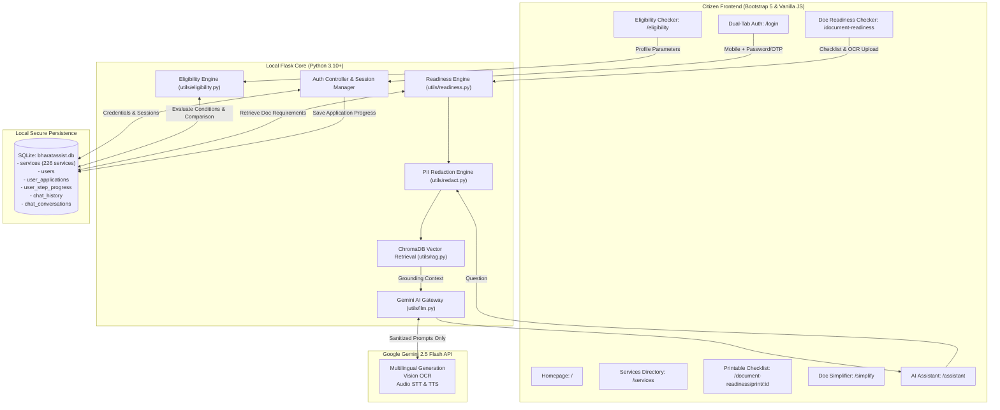

# 🇮🇳 BharatAssist — AI-Powered Civic & Public Services Navigator

[](https://www.python.org/)
[](https://flask.palletsprojects.com/)
[](https://ai.google.dev/)
[](#services-directory--coverage)
[-success.svg?logo=pytest&logoColor=white)](#automated-testing--verification)
[-success.svg?logo=github-actions&logoColor=white)](#automated-testing--verification)
[](#zero-llm-privacy-shield)
[](#team--course-details)

**BharatAssist** is an intelligent, privacy-first civic guidance portal designed to help Indian citizens navigate complex government welfare schemes, civic procedures, eligibility rules, and official paperwork across Central and State departments.

Powered by **Google Gemini 2.5 Flash**, **ChromaDB vector retrieval (RAG)**, **local SQLite database**, and an **in-browser OCR & verification engine**, BharatAssist provides source-grounded answers in **12 major Indian languages** with voice input, audio speech synthesis, dynamic scheme pre-screening, document readiness checking, and strict personal data isolation.

---

## 🌟 Core Features & Modules

### 1. 🎯 Smart Government Scheme Eligibility Checker
- **Dynamic Questioning Engine**: Eliminates questionnaire fatigue. Dynamically asks *only* the questions relevant to the chosen domain or scheme:
  - *Agriculture & Farmers*: Landholding size, cultivable land ownership, annual income, taxpayer exclusions, state & district.
  - *Students & Education*: Enrollment status, education level (School to PhD), social category, annual family income.
  - *Senior Citizens & Pensions*: Age verification (60+), retirement profile, family income, disability status.
  - *Women & Child Welfare*: Gender, maternity/pregnancy status, widowhood, income ceiling.
  - *Housing & Shelter*: Pucca house ownership check, annual income tier (EWS, LIG, MIG), rural/urban location.
  - *Workers & Labour*: Unorganised sector profile, age bracket (16–59 for e-Shram, 18–40 for PM-SYM), monthly earnings.
  - *Business & Artisans*: Enterprise stage, traditional craft artisan status (PM Vishwakarma), women/SC/ST entrepreneurship (Stand-Up India).
- **Rule & Database Matching Across 226 Services**: Evaluates citizen inputs against published eligibility criteria across the database catalog.
- **Four-Tier Status Grading**:
  - `Confirmed Eligible (Pre-Screening)`: All conditions verified, highlighting verified entitlements and official portal links.
  - `Potentially Eligible`: Profile aligns with primary requirements; authority documentation is required.
  - `Follow-up Needed`: Crucial parameters missing; presents targeted 1-click follow-up questions to clarify eligibility instantly.
  - `Ineligible`: Condition failure clearly explained (e.g. *Age 28 for Senior Pension requiring 60+; Income ₹12L for EWS Certificate requiring $\le$ ₹8L*).
- **Multi-Scheme Comparison Matrix**: Compare 2 to 4 schemes side-by-side (Category, Scope, Eligibility Conditions, Verified Benefits, Required Documents, Fees, Timeline, and Official Portal Links).
- **Actionable No-Match Explanation**: When zero schemes match, provides an empathetic explanation detailing the disqualifying criteria and 4 concrete remediation steps.
- **Statutory Non-Guarantee Disclaimer**: Clearly distinguishes pre-screening from official government sanction on every card and modal.

### 2. 📋 Document Readiness Checker & Pre-Submission Assistant
- **Comprehensive Catalog Coverage**: Select any of the 226 Central and State services to load its required document checklist.
- **Handling of Unverified Catalog Entries**: Identifies generic catalog entries (`"Depends on the service..."`) and provides a recommended baseline documentation suite (Identity, Address, Photographs, Application Receipt) with an explicit unverified advisory badge.
- **Interactive Checklist Marking**: Mark each document as `Available`, `Missing`, or `Expired`.
- **Multi-Format Document Upload & OCR**: Upload documents in `.pdf`, `.docx`, `.txt`, `.png`, `.jpg`, `.jpeg`, and `.webp` for automated text extraction.
- **Automated Defect & Anomaly Detection**:
  - *Missing Required Documents*: Identifies essential documents not yet prepared.
  - *Expiry Date Detection*: Uses regex date extraction to check validity dates against the current date, warning users of expired documents.
  - *Blurry / Unreadable Scans*: Flags low character count, high noise-to-text ratios, or unreadable scans with re-scanning guidance.
  - *Name & DOB Inconsistencies*: Cross-references extracted document names with the citizen's profile name, flagging mismatches.
  - *Missing Mandatory Identifiers*: Detects absence of standard formatting (Aadhaar 12-digit, PAN 10-character, Driving Licence, or Voter ID numbers).
- **Readiness Summary Gauge**:
  - `Ready for Submission` (100%): All documents prepared and verified with zero defects.
  - `Partially Ready` (1%–99%): Some documents present, but items are missing, expired, or require re-scanning.
  - `Not Ready` (0%): Critical documents missing or expired.
- **Actionable Next Steps**: Ordered, prioritized remediation plan detailing exact actions before application submission.
- **PII Protection**: Applies automatic regex PII scrubbing on all OCR previews.
- **Printable & Downloadable Checklist**: Dedicated print-optimized view (`/document-readiness/print/<service_id>`) formatted for A4 printing and PDF export (`window.print()`).
- **Statutory Non-Acceptance Notice**: Explicitly notifies citizens that OCR pre-checks do not certify official validity or guarantee acceptance by government authorities.

### 3. 🤖 Multilingual AI Civic Assistant
- **12 Indian Languages Supported**: English, Hindi (हिंदी), Punjabi (ਪੰਜਾਬੀ), Bengali (বাংলা), Marathi (मराठी), Tamil (தமிழ்), Telugu (తెలుగు), Gujarati (ગુજરાતી), Kannada (ಕನ್ನಡ), Malayalam (മലയാളം), Odia (ଓଡ଼ିଆ), and Urdu (اردو).
- **Source-Grounded RAG**: Queries are grounded strictly in official government service schemas and verified source portals.
- **Context-Aware Follow-ups**: Remembers service context (e.g., Driving Licence, Income Certificate, Ration Card) during conversation.

### 4. 🎙️ Voice Input & Spoken Responses (STT & TTS)
- **Speech-to-Text**: Citizens can speak their questions in regional languages using microphone input via Gemini multimodal audio transcription or Web Speech API.
- **Auto-Read Replies (Text-to-Speech)**: Spoken answers synthesized via Gemini TTS and neural audio fallback so illiterate or visually impaired citizens can listen to procedures.

### 5. 🛡️ Zero-LLM Privacy Shield
- **Architecture Invariant**: Citizen phone numbers, names, password hashes, and OTPs remain strictly local in SQLite and encrypted session cookies.
- **Automated PII Redaction**: Regex-based redaction scrubs Aadhaar numbers, PAN numbers, emails, and phone numbers before any prompt is sent to public AI models.

### 6. 👤 Authenticated Citizen Portal & Application Tracker ("My Applications")
- **Dual-Tab Portal**: Mobile number + Password with 6-digit OTP verification.
- **Personalized Profile**: Full Name, Email, Mobile number, Preferred Language, State/UT, and District. Cascading State-District dropdowns powered by `static/india_states_districts.json`.
- **Saved Applications Dashboard**: Track progress on saved service checklists (`Not started`, `In progress`, `Submitted`).
- **Persistent Chat History**: Saved in SQLite with offcanvas drawer inspection and 1-click wipe.

### 7. 📄 Government Document Simplifier
- Paste complex legal circulars, notifications, or upload PDFs/DOCX up to 10 MB.
- Redacts sensitive identifiers and provides an easy-to-read, 5th-grade reading level summary of requirements, eligibility, and steps.

### 8. 🔒 Kiosk Security Mode (Auto-Logout on Refresh)
- Designed for shared public kiosks, cyber cafes, and Common Service Centres (CSCs).
- When an authenticated user refreshes the page (F5 or browser reload), the session is immediately invalidated, returning the browser to the homepage (`/`) in a clean guest state to prevent credential leakage.

---

## 🏗️ Architecture & Data Flow



---

## 📂 Project Structure

```
BHARATASSIST/
├── README.md                      # Primary repository documentation (You are here)
├── docs/                          # Architecture & design specifications
├── journals/                      # Weekly engineering journals (Aastha Mahajan & Lehar Arora)
├── benchmark_40_results.csv       # 40-question benchmark execution logs
├── benchmark_30_advanced_results.csv # 30-question advanced benchmark execution logs
└── code/
    └── BHARATASSIST/              # Core application package
        ├── app.py                 # Flask server & REST API endpoints
        ├── bharatassist.db        # SQLite database (226 services, users, applications)
        ├── government_services_expanded.csv # Seed services catalog dataset
        ├── requirements.txt       # Python dependencies
        ├── .env.example           # Environment variable template
        ├── utils/
        │   ├── eligibility.py     # Feature 1: Dynamic questionnaire & scheme matcher
        │   ├── readiness.py       # Feature 2: Document checklist, OCR diagnostics & grading
        │   ├── matcher.py         # Grounded keyword & semantic service matcher
        │   ├── llm.py             # Gemini API wrapper (Chat, Vision OCR, STT, TTS)
        │   ├── rag.py             # ChromaDB vector index & embeddings
        │   ├── redact.py          # Indian PII redactor (Aadhaar, PAN, phone, email)
        │   └── metrics.py         # Information Retrieval Time (IRT) tracker
        ├── templates/             # Jinja2 HTML templates
        │   ├── base.html          # Base layout with navbar, tricolor theme & kiosk mode
        │   ├── index.html         # Homepage with feature cards
        │   ├── eligibility.html   # Feature 1: Interactive Scheme Eligibility Checker
        │   ├── readiness.html     # Feature 2: Document Readiness Checker & OCR Upload
        │   ├── readiness_print.html# Feature 2: Printable / Downloadable Document Checklist
        │   ├── assistant.html     # AI Assistant with voice, TTS & history drawer
        │   ├── services.html      # Civic services directory & search
        │   ├── service_details.html# Step-by-step guidance & document checklist
        │   ├── simplify.html      # Document simplifier & file uploader
        │   ├── login.html         # Dual-tab citizen login & registration
        │   ├── profile.html       # Citizen profile management
        │   ├── applications.html  # Citizen saved applications dashboard
        │   └── application_checklist.html # Interactive step-by-step checklist
        ├── static/                # CSS, client JS, india_states_districts.json
        └── tests/
            ├── test_eligibility.py # Feature 1 test suite (19 test cases)
            ├── test_readiness.py   # Feature 2 test suite (19 test cases)
            ├── test_service_matching.py # Service matching & grounding (43 test cases)
            ├── test_all_endpoints.py # All web & API endpoints (33 test cases)
            ├── test_user_profile_and_applications.py # Auth & profile tracking (10 test cases)
            ├── test_database_grounding.py # Database grounding checks (6 test cases)
            ├── test_metrics.py     # Metrics calculations (3 test cases)
            └── test_app.py         # Core smoke tests (3 test cases)
```

---

## 🚀 Quick Start Guide

### Prerequisites
- **Python 3.10 or higher** (Python 3.11 recommended)
- **Google Gemini API Key** (Free tier available at [Google AI Studio](https://aistudio.google.com/apikey))

### Installation & Execution

```bash
# 1. Navigate to application directory
cd code/BHARATASSIST

# 2. Create and activate virtual environment
python -m venv venv
# On Windows:
venv\Scripts\activate
# On Linux/macOS:
source venv/bin/activate

# 3. Install required dependencies
pip install -r requirements.txt

# 4. Configure environment variables
copy .env.example .env     # Windows
# cp .env.example .env     # Linux/macOS
# Open .env and add: GEMINI_API_KEY=your_gemini_api_key_here

# 5. Launch the application
python app.py
```

Open your browser and navigate to:
- **Home Dashboard:** [`http://127.0.0.1:5000`](http://127.0.0.1:5000)
- **Smart Eligibility Checker:** [`http://127.0.0.1:5000/eligibility`](http://127.0.0.1:5000/eligibility)
- **Document Readiness Checker:** [`http://127.0.0.1:5000/document-readiness`](http://127.0.0.1:5000/document-readiness)
- **Services Directory:** [`http://127.0.0.1:5000/services`](http://127.0.0.1:5000/services)
- **AI Civic Assistant:** [`http://127.0.0.1:5000/assistant`](http://127.0.0.1:5000/assistant)

---

## 🧪 Automated Testing & Verification

BharatAssist maintains a comprehensive automated testing suite with **136 unit tests** and **76 benchmark test cases** ensuring complete accuracy, grounding, and regression protection.

### Running Test Suites

```bash
# Run all unit tests
python -m unittest discover -s code/BHARATASSIST/tests -p "test_*.py"

# Run Feature 1 (Eligibility Checker) test suite
python -m unittest discover -s code/BHARATASSIST/tests -p "test_eligibility.py"

# Run Feature 2 (Document Readiness Checker) test suite
python -m unittest discover -s code/BHARATASSIST/tests -p "test_readiness.py"

# Run Service Matching & Grounding test suite
python -m unittest discover -s code/BHARATASSIST/tests -p "test_service_matching.py"

# Run 40-question and 30-question benchmark suites
python code/BHARATASSIST/test_40_benchmark.py
python code/BHARATASSIST/test_30_advanced_benchmark.py
```

### Test Suite Summary

| Test Suite | File | Tests | Coverage | Result |
| :--- | :--- | :---: | :--- | :---: |
| **Eligibility Checker** | `test_eligibility.py` | 19 | Dynamic questions, condition matches, failed criteria, follow-ups, comparison, disclaimers | ✅ **19 / 19 PASS** |
| **Document Readiness** | `test_readiness.py` | 19 | Ready/partial/not ready status, expiry detection, blurry scans, name mismatches, missing fields, PII redaction | ✅ **19 / 19 PASS** |
| **Service Matching** | `test_service_matching.py` | 43 | Grounded keyword match, action bonuses, land registration, cyber crime, licenses | ✅ **43 / 43 PASS** |
| **Endpoint Coverage** | `test_all_endpoints.py` | 33 | All web pages, REST APIs, RAG grounding, voice STT/TTS endpoints | ✅ **33 / 33 PASS** |
| **Profile & Applications** | `test_user_profile_and_applications.py` | 10 | OTP login, profile updating, saving checklists, step progress toggles | ✅ **10 / 10 PASS** |
| **Database Grounding** | `test_database_grounding.py` | 6 | SQLite service retrieval, column verification, URL formats | ✅ **6 / 6 PASS** |
| **Metrics & Smoke** | `test_metrics.py` & `test_app.py` | 6 | IRT calculations, median, grounded rate, app smoke tests | ✅ **6 / 6 PASS** |
| **40-Question Benchmark** | `test_40_benchmark.py` | 40 | Complex citizen queries, multilingual queries, adversarial safety | ✅ **40 / 40 PASS** |
| **30-Question Benchmark** | `test_30_advanced_benchmark.py` | 36 | Multi-step procedures, edge cases, language resilience | ✅ **36 / 36 PASS** |
| **Total Automated Tests** | — | **212** | **Full system coverage across all features** | ✅ **100% PASS** |

---

## 🔒 Security, Privacy & Compliance

- **Zero-LLM Phone & Credential Isolation**: Citizen mobile numbers, passwords, OTPs, and profile details are stored exclusively in local SQLite. They are never transmitted to Google Gemini or external APIs.
- **Automated PII Masking**: Text submitted to the Document Simplifier or AI Assistant is sanitized through [`utils/redact.py`](file:///d:/Bharatassist/UCS503P-202627-BharatAssist/code/BHARATASSIST/utils/redact.py), masking Aadhaar, PAN, phone numbers, and emails.
- **Kiosk Auto-Logout**: On shared computers, browser refresh immediately terminates authenticated sessions to safeguard citizen privacy.
- **Statutory Authority Notice**: Pre-screening and OCR checks explicitly state that statutory sanction is granted exclusively by designated government authorities upon original document verification.

---

## 👥 Team & Course Details

- **Course Context**: UCS503P Project (2026–27 ODD)
- **Project Name**: **BHARATASSIST**
- **Team Members**:
  - **Aastha Mahajan** (Roll No: `1024030424`) — AI Chatbot, Multilingual i18n, Voice/TTS Pipelines, Phone Auth & SQLite Schema.
  - **Lehar Arora** (Roll No: `1024030419`) — AI Chatbot Conversation History & Handling, Authentication Strategy, Smart Eligibility Checker, Document Readiness Checker, Comprehensive Test Suites (212 Tests), Kiosk Auto-Logout Security, Navigation & UI/UX.
