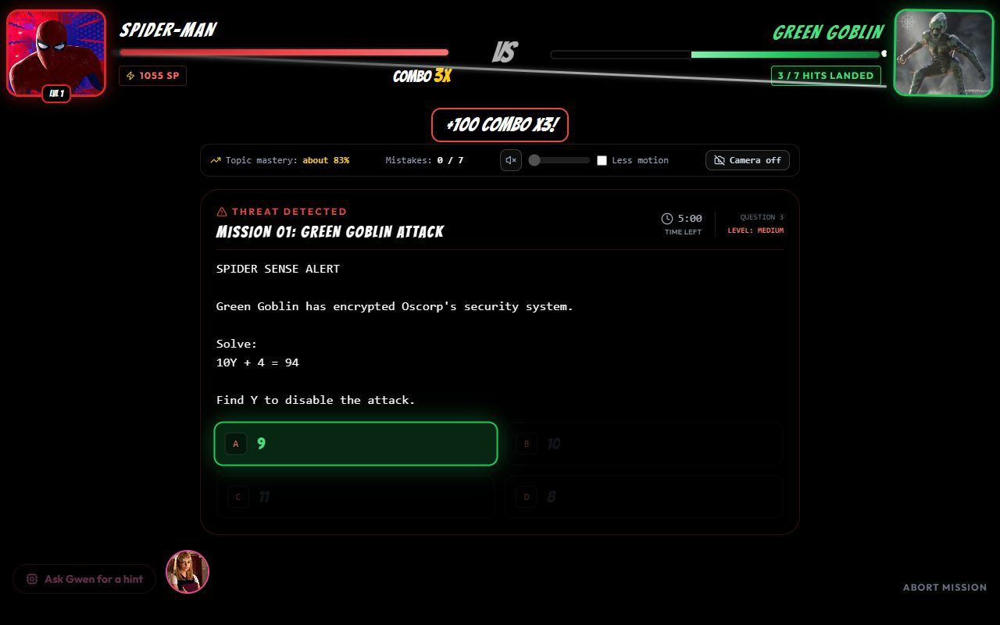
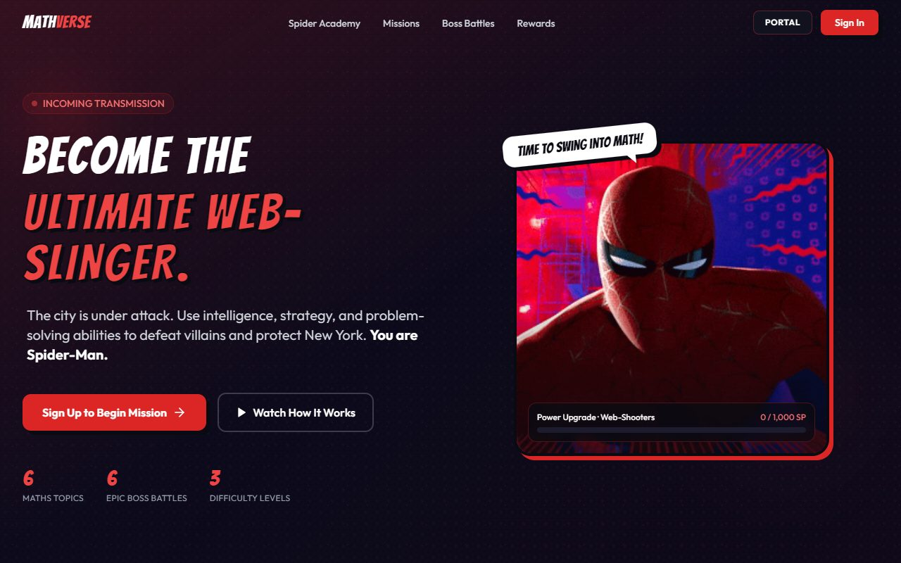
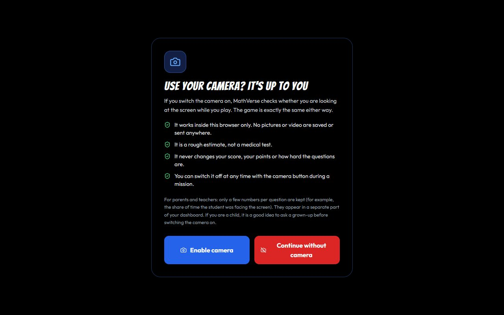
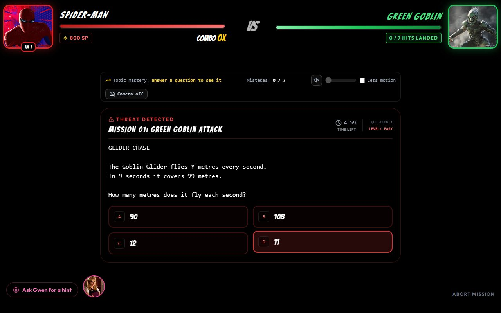
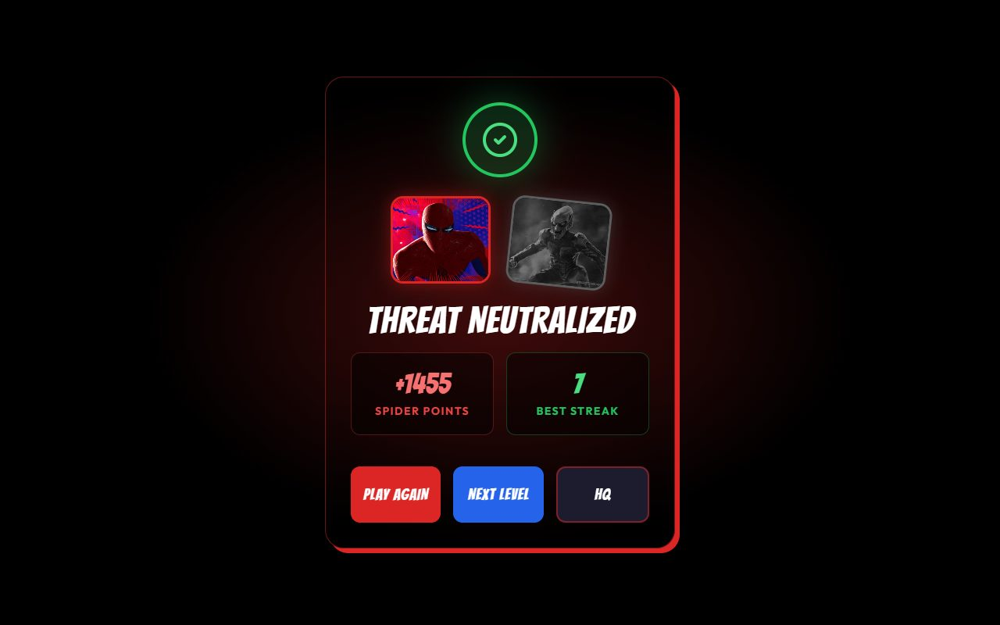
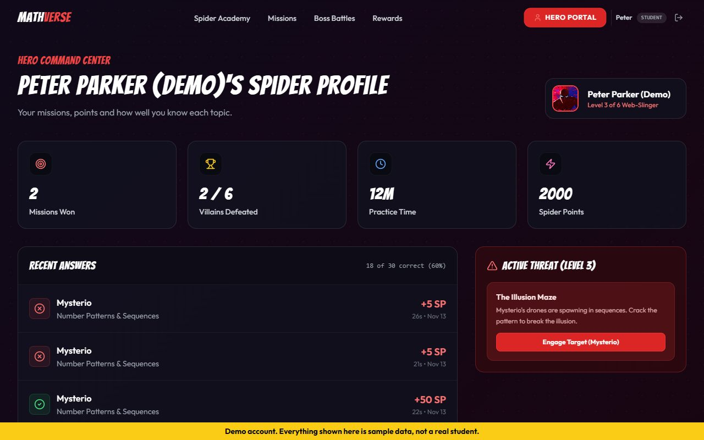
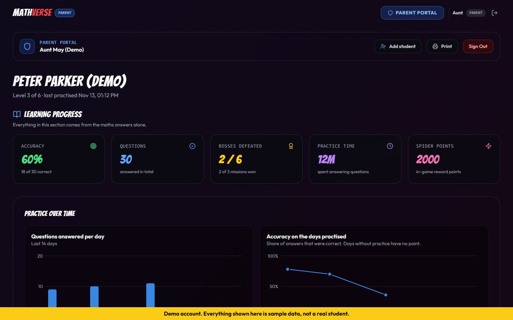
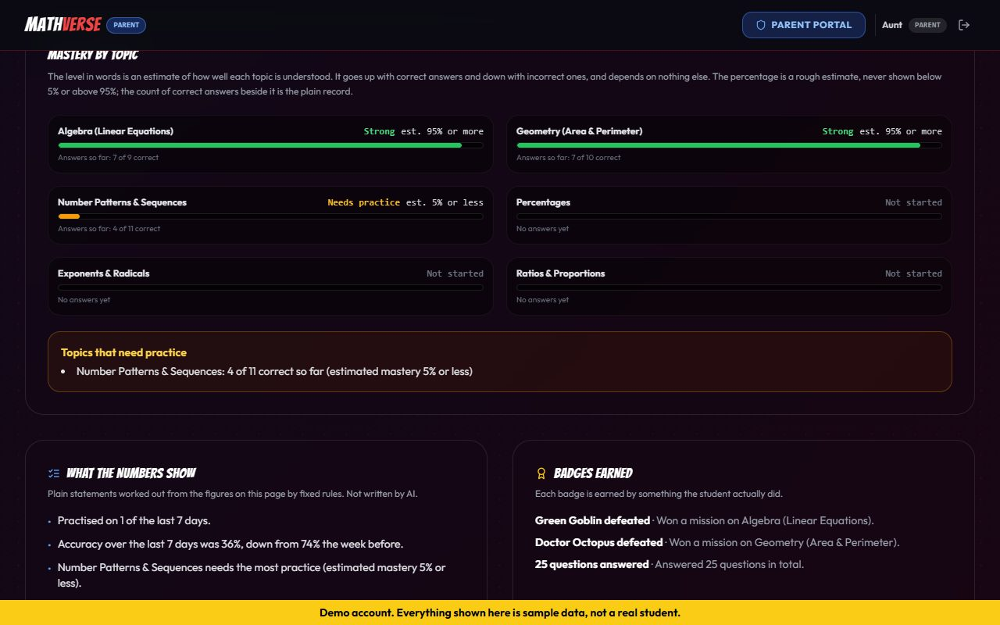
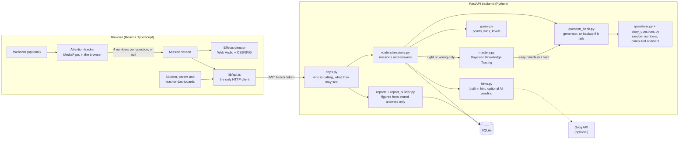

# MathVerse

Maths practice as superhero boss battles. Students play Spider-Man against six
villains, one per maths topic. Questions adapt to how well the student knows
each topic, and parents and teachers get honest progress reports built only from
what the student actually answered.

Built for UCS503P Software Engineering (2026-27 ODD), Thapar Institute of
Engineering and Technology, Patiala.



## Contents

- [The problem and who it is for](#the-problem-and-who-it-is-for)
- [Screenshots](#screenshots)
- [Features](#features)
- [By the numbers](#by-the-numbers)
- [Tech stack](#tech-stack)
- [System architecture](#system-architecture)
- [What the "AI" parts really are](#what-the-ai-parts-really-are)
- [Run it locally](#run-it-locally)
- [Tests](#tests)
- [Project layout](#project-layout)
- [Known limits](#known-limits)

## The problem and who it is for

Maths practice is repetitive, and it is hard to tell from a worksheet score which
topic a child actually struggles with. MathVerse turns practice into short
missions and keeps a per-topic estimate of what the student knows.

| User | What they do | What they get |
|---|---|---|
| **Student** | Plays missions: each villain is beaten with seven correct answers | Questions pitched at their level, points, levels, badges, and character effects that react to every answer |
| **Parent** | Links to their child with a code the child shares | A report: accuracy, practice over time, mastery per topic, topics to practise next, earned badges |
| **Teacher** | Links to several students the same way | The same report for each student in the class |

**Use cases**

1. A student signs up, starts the first mission and chooses whether to switch on
   the camera. The game is the same either way.
2. The server picks each question's difficulty from the student's mastery of
   that topic, generates it, and keeps the answer to itself.
3. The student answers. The server judges the answer, updates mastery, awards
   points, and sends the next question. Wins unlock the next villain.
4. The student asks Gwen for a hint when stuck.
5. A parent or teacher enters the student's link code and opens the report.
6. For a demo, one-click demo accounts show a filled-in student, parent and
   teacher without registering (off by default).

## Screenshots

| | |
|---|---|
|  |  |
| **Landing page** | **Camera consent.** Asked once, either answer gives the same game. |
|  |  |
| **A mission.** A story question, the health bars, sound and motion controls, the hint button. | **A combo.** Spider-Man's web reaches the villain's portrait after three correct answers in a row. |
|  |  |
| **Victory.** Points earned and best streak. | **Student dashboard** (demo account) |
|  |  |
| **Parent report:** headline figures and practice over time | **Parent report:** mastery by topic, rule-based observations, badges |

The demo screenshots show seeded sample data, labelled as such on every screen.

## Features

**Gameplay**
- Six villains, one topic each: Green Goblin (linear equations), Doctor Octopus
  (area and perimeter), Mysterio (sequences), Venom (percentages), The Lizard
  (exponents and roots), Kingpin (ratios). Winning against one unlocks the next.
- Three difficulty tiers per topic, chosen from the student's mastery.
- About half the questions are **story questions** told through the villain's
  world: Goblin's pumpkin bombs, Doc Ock's metal arms, Mysterio's illusions,
  Venom's symbiote, the Lizard's serum, Kingpin's empire.
- Points for every attempt, bonuses for streaks and speed, a victory bonus,
  levels and badges.
- **Character effects:** each character has its own synthesised sounds and
  visual effects (web shots, pumpkin bombs, tentacles, illusions, tail sweeps,
  shock rings), combo specials at streaks of 3, 5 and 7, a signature move from
  the villain, and a defeat sequence. Mute, volume and reduced motion are
  remembered on the device.

**Learning**
- Bayesian Knowledge Tracing keeps one mastery estimate per student per topic,
  driven only by right and wrong answers.
- Reports show the mastery band first and the percentage capped to 5–95%, beside
  the plain count of correct answers, so a parent never sees a misleading 1% or 99%.
- Hints for every question, written from the question's own numbers.

**Trust and privacy**
- The server owns the truth: it generates questions, keeps the answer, and
  awards points. The client cannot score itself.
- The camera is optional. Faces are analysed inside the browser and only four
  numbers per question are sent. No image or video is stored or uploaded, and
  the attention estimate never affects marks, difficulty or points.
- Parents and teachers see a student only after entering that student's link code.
- Every dashboard number comes from stored answers. Nothing is invented.

## By the numbers

All figures are counted from the code and test runs on 19 November 2026.

| | |
|---|---|
| Villains / maths topics | 6 |
| Difficulty tiers per topic | 3 |
| Plain question generators | 18 (6 villains × 3 tiers) |
| Story question templates | 36 (6 per villain, 2 per tier) |
| Fixed backup questions | 36, used only if the generator ever fails |
| Different questions possible | effectively unlimited: numbers are random, answers computed |
| API endpoints | 12 |
| Database tables | 5 |
| Synthesised sounds | 79, all generated in code |
| Visual effect types | 57 |
| Effect variations | 95, dealt so the same one does not repeat back to back |
| Backend tests | 443 (pytest) |
| Frontend tests | 225 (Vitest) |
| Real-browser camera checks | 32 (`npm run check:camera`) |
| Backend code | about 2,600 lines of Python, plus 1,600 lines of tests |
| Frontend code | about 7,200 lines of TypeScript and CSS, plus 2,000 lines of tests |
| Frontend runtime dependencies | 4 (React, React DOM, MediaPipe, an icon set) |

**Game rules**

| Rule | Value |
|---|---|
| Correct answers to win a mission | 7 |
| Wrong answers or time-outs to lose | 7 |
| Time per question | 5 minutes |
| Points for a correct answer | 50, plus 15 for each answer already in the current streak, plus 20 if answered within 15 seconds |
| Points for a wrong attempt | 5 (a time-out earns 0) |
| Victory bonus | 300 + 50 × the final streak |
| Levels | 1 to 6: one more for each different villain defeated |

**Mastery model**

| Parameter | Value |
|---|---|
| Starting estimate | 0.30 |
| Guess (right without knowing) | 0.25, as there are four options |
| Slip (wrong despite knowing) | 0.10 |
| Learning step after a correct answer | 0.15 |
| Easy below / hard above | 0.40 / 0.75 |
| Stored range / shown range | 0.01–0.99 / 5–95% |

**Camera estimate**

| Setting | Value |
|---|---|
| Readings per second | about 10 |
| Calibration (the student's resting head position) | first 5 seconds |
| Counts as facing the screen | within 30° left or right and 20° up or down of that position |
| Sent to the server per question | 4 numbers: face present %, facing the screen %, blink rate, seconds measured |

## Tech stack

| Layer | Technology | Used for |
|---|---|---|
| Frontend | React 18, TypeScript, Vite | The single-page app |
| Styling | Tailwind CSS, plain CSS animations, inline SVG | Layout, comic styling, character effects |
| Sound | Web Audio API | Every character sound, synthesised in the browser |
| Computer vision | MediaPipe Tasks Vision (FaceLandmarker) | The optional camera estimate, run entirely in the browser via WebAssembly |
| Backend | Python, FastAPI, Pydantic | The API, request validation (unknown fields rejected) |
| Database | SQLAlchemy, SQLite | Accounts, missions, answers, mastery |
| Security | bcrypt, JWT (python-jose) | Password hashing, sign-in tokens, role checks |
| Optional AI | Groq API (`openai/gpt-oss-120b`) | Rewording a hint in character; nothing else |
| Testing | pytest, Vitest, React Testing Library, Playwright | Backend, frontend and real-browser camera checks |
| CI | GitHub Actions | Tests, typecheck, lint and build on every push |

## System architecture



**One question, start to finish**

1. The mission screen asks the server for a question.
2. The server reads the student's mastery for the villain's topic, picks a tier,
   and builds a question from random numbers. The answer is computed and stored
   with the question; only the text and four options go to the browser.
3. The student picks an option. The browser sends the choice, the time taken,
   and the camera summary (or `null` if the camera is off).
4. The server judges the answer, updates mastery from right or wrong alone,
   awards points, updates the mission, and replies with the result and the next
   question.
5. The browser turns the result into game events (strike, counter-attack, combo,
   signature move, victory) and plays the matching sounds and effects.

**Data model**

| Table | Holds |
|---|---|
| `users` | Accounts: name, email, bcrypt password hash, role, points, level, link code, demo flag |
| `guardian_links` | Which parent or teacher is linked to which student |
| `play_sessions` | Missions: villain, status, correct and wrong counts, streak, points |
| `attempts` | Every question served, its stored answer, the student's choice, time, hint use, points, mastery before and after, and the optional camera numbers |
| `topic_mastery` | One mastery estimate per student per topic |

The full design, including the mastery formulas with a worked example, is in
[docs/ARCHITECTURE.md](docs/ARCHITECTURE.md). What is collected and why is in
[docs/PRIVACY.md](docs/PRIVACY.md).

## What the "AI" parts really are

| Part | What it is | What it is not |
|---|---|---|
| Mastery | Bayesian Knowledge Tracing: one probability per student per topic, updated from right and wrong answers only | Not a neural network; the parameters are standard defaults, not fitted to data |
| Questions | Generated from random numbers with computed answers, checked by tests | Not written by a language model |
| Hints | A verified built-in hint, optionally reworded by a language model (Groq) | The model never writes the maths, and the game works without it |
| Attention estimate | MediaPipe face landmarks in the browser: face present, head facing the screen, blink rate | Not eye tracking, not a medical or ADHD assessment, and never used for scoring |

## Run it locally

You need Python 3.10 or newer and Node.js 18 or newer.

### 1. Backend

```bash
cd backend
python -m venv venv
```

Activate the environment: `venv\Scripts\activate` on Windows, or
`source venv/bin/activate` on macOS and Linux. Then:

```bash
pip install -r requirements.txt
```

Create `backend/.env` by copying `backend/.env.example`, and set
`JWT_SECRET_KEY` to a long random string. This prints one:

```bash
python -c "import secrets; print(secrets.token_urlsafe(48))"
```

Start the server:

```bash
uvicorn main:app --port 8001 --reload
```

The API is at `http://localhost:8001` and its interactive docs at
`http://localhost:8001/docs`. The database file `backend/mathverse.db` is
created on first start.

### 2. Frontend

In a second terminal:

```bash
cd frontend
npm install
npm run dev
```

Open `http://localhost:5173`.

### 3. Optional settings (`backend/.env`)

| Setting | Effect |
|---|---|
| `DEMO_MODE=true` | Shows one-click demo buttons on the sign-in dialog. Run `python seed.py --demo` once first to create the three demo accounts with sample data. Off by default. |
| `GROQ_API_KEY=...` | Lets a language model reword hints in character. Without it the built-in hints are used. |
| `CORS_ORIGINS=...` | Comma-separated frontend addresses allowed to call the API. |

### Try it

1. Sign up as a student and start the first mission.
2. Answer a few questions. The level (easy, medium, hard) follows your answers.
3. Open your dashboard and copy your link code.
4. In another browser profile, sign up as a parent and enter that code to see
   the report.

Extra pages for development: `?soundboard=1` plays every sound and effect, and
`?attentionDebug=1` shows the live camera numbers as text during a mission.

## Tests

```bash
cd backend
pytest
```

```bash
cd frontend
npm run test
npm run typecheck
npm run lint
npm run build
```

With both servers running, this drives the real app in headless Chrome with a
pretend webcam:

```bash
cd frontend
npm run check:camera
```

**What the tests cover**

- Sign-in, roles, and that nobody can read another account's data by changing an
  id; demo login limits.
- Every question type and every story at every tier, re-solved independently
  from the question text (hundreds of random questions each); every backup
  question; a full mission won on backup questions alone.
- The game rules and the mastery model, including that the camera never changes
  mastery, difficulty or points.
- Reports checked against hand-computed values, and that missing camera data
  stays empty instead of becoming zero.
- The camera consent flow: declining, denial, switching off mid-mission, and that
  no image is ever uploaded.
- Sound and effect limits: at most four sounds at once, nothing covering the
  question, reduced motion, settings that persist.

CI runs the backend and frontend suites, typecheck, lint and build on every push.

## Project layout

```
backend/
  main.py              app and route wiring
  config.py            settings from environment / .env
  models.py            database tables
  schemas.py           request and response shapes
  security.py          password hashing and sign-in tokens
  deps.py              who is calling and what they may see
  seed.py              demo accounts (--demo) and database reset (--reset)
  routers/             auth, sessions (gameplay), guardians, reports
  services/            questions, story questions, backup bank, mastery,
                       hints, attention, game rules, report builder
  tests/
frontend/src/
  lib/api.ts           the one client for the backend
  lib/attention/       in-browser camera tracking and its summary
  lib/effects/         sound engine, sound recipes, visual cues, character profiles
  context/             sign-in state and game progress
  components/          screens; dashboard/ holds the report and charts
docs/
  ARCHITECTURE.md      how it works and how to explain it
  PRIVACY.md           what is collected and what is not
  WEBCAM_TEST_PLAN.md  real-device camera checklist and results
  AUDIT_AND_PLAN.md    the audit this version was built from
  screenshots/         the images in this README
journals/, project-proposal/, project-report-prototype-stage/, srs/   coursework
```

## Known limits

- The attention estimate has been checked on one real device only (one laptop
  webcam, Chrome, one person, 16 November 2026) and in a real browser with a
  pretend webcam. Other cameras, browsers, lighting and devices are untested.
  Results and what is left are in [docs/WEBCAM_TEST_PLAN.md](docs/WEBCAM_TEST_PLAN.md).
- The "facing the screen" figure reflects head direction, not eye gaze. On the
  tested laptop it caught turning away and leaving, but not looking down at the
  keyboard or lap.
- Mastery parameters are textbook defaults; with them, mastery moves quickly.
- The camera choice is made by whoever is using the device. This suits a course
  demo; real use with children needs verified parent consent, as described in
  [docs/PRIVACY.md](docs/PRIVACY.md).
- Fonts are loaded from Google Fonts.
- Spider-Man and related characters belong to Marvel. They are used here in a
  non-commercial course project; the project is not affiliated with or endorsed
  by Marvel and should not be deployed publicly as it stands.
