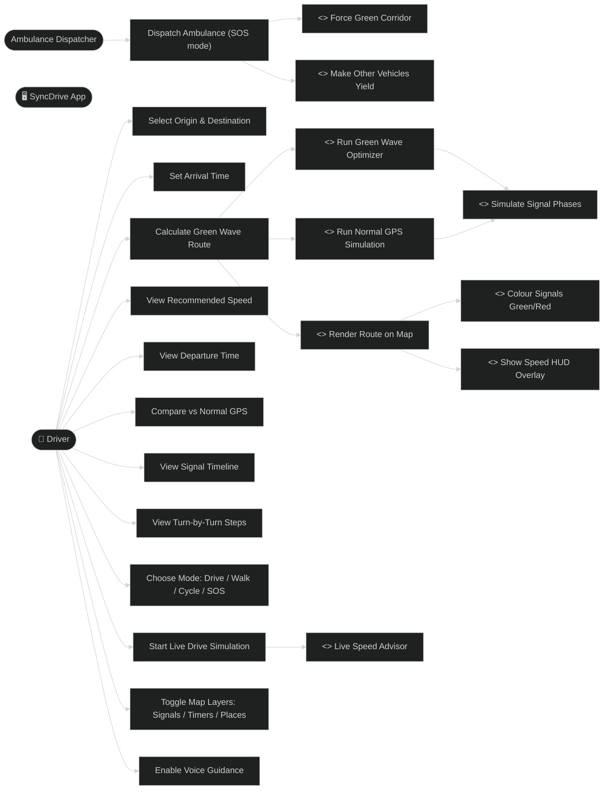

# Use Case Diagram — SyncDrive

## Description

| Use Case | Actor | Description |
|---|---|---|
| Select Origin & Destination | Driver | Choose from 14 Chandigarh locations, or click a place on the map |
| Set Arrival Time | Driver | Target time to reach destination |
| Calculate Green Wave Route | Driver | Triggers full optimization pipeline |
| View Recommended Speed | Driver | Steady km/h to maintain on route |
| View Departure Time | Driver | Optimal leave-at time |
| Compare vs Normal GPS | Driver | Time saved, reds avoided, wait time |
| View Signal Timeline | Driver | Per-signal green/red status + arrival time |
| View Turn-by-Turn Steps | Driver | Street-level directions |
| Run Green Wave Optimizer | System | Searches 15 speeds × 25 min window, plus per-stretch speed refinement |
| Run Normal GPS Simulation | System | Naive departure (no signal knowledge), 50 km/h, accumulates waits |
| Simulate Signal Phases | System | phase = (dep + travel + elapsed) % cycle |
| Render Route on Map | System | Blue polyline + ghost red dashed overlay |
| Colour Signals Green/Red | System | Updates signal circle fill colours |
| Show Speed HUD Overlay | System | Bottom-right speed badge on map |
| Choose Mode | Driver | Drive, Walk, Cycle (speed profiles) or SOS (ambulance) |
| Start Live Drive Simulation | Driver | Race SyncDrive vs Normal GPS at 1x-16x with pause, follow-camera and manual speed |
| Toggle Map Layers | Driver | All layers / Signals / Timers / Places on or off |
| Enable Voice Guidance | Driver | Spoken advice in a female English voice, voice selectable |
| Dispatch Ambulance | Dispatcher | SOS mode: ambulance run with green corridor |
| Force Green Corridor | System | Signals within 500 m ahead of the ambulance forced green |
| Make Other Vehicles Yield | System | Vehicles within 350 m ahead slow to 6-12 km/h and hold at corridor signals |
| Live Speed Advisor | System | Suggests the speed that reaches the next signal on green |
