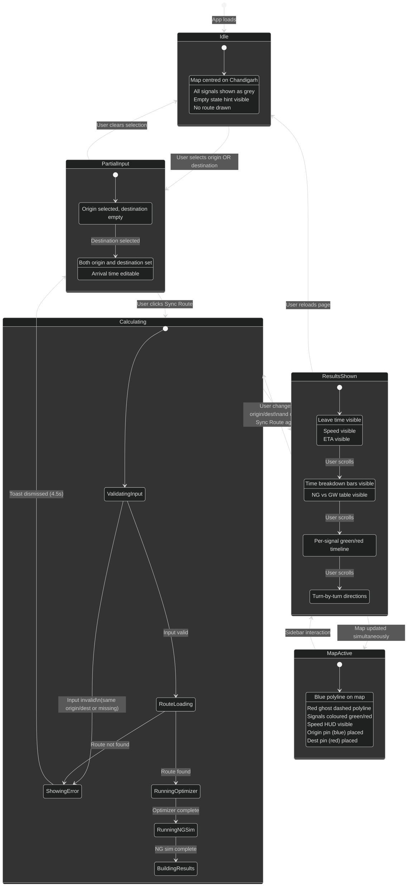

# State Machine Diagram — SyncDrive UI



## Drive Simulation and SOS States

```mermaid
%%{init: {"theme": "dark"}}%%
stateDiagram-v2
    [*] --> LiveSignals : App loads (signals follow real clock)
    LiveSignals --> RouteReady : Sync Route
    RouteReady --> Driving : Start live drive (Drive / Walk / Cycle)
    RouteReady --> EmergencyReady : Switch to SOS mode
    EmergencyReady --> EmergencyRun : Dispatch ambulance

    state Driving {
        [*] --> Cruising
        Cruising --> Stopped : red on arrival
        Stopped --> Cruising : green
        Cruising --> Adjusting : advisor suggests new speed
        Adjusting --> Cruising
        Driving --> Paused : Pause
        Paused --> Driving : Resume
    }

    state EmergencyRun {
        [*] --> Dispatching : 20 s head start for other cars
        Dispatching --> CorridorActive : ambulance moves
        CorridorActive : signals within 500 m forced green
        CorridorActive : other vehicles yield within 350 m
        CorridorActive --> Arrived : destination reached
    }

    Driving --> Finished : SyncDrive arrives
    EmergencyRun --> Finished : ambulance arrives
    Finished --> Driving : Replay
    Driving --> LiveSignals : Stop
    EmergencyRun --> LiveSignals : Stop
```
