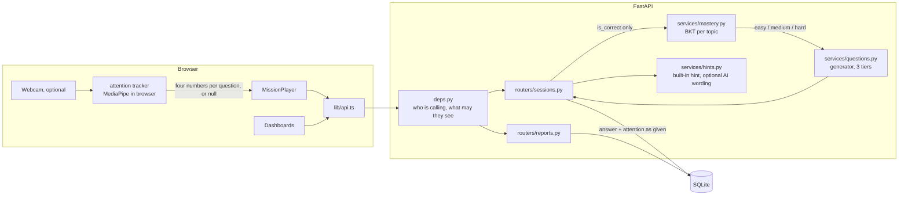

# MathVerse architecture

How the system fits together, and how to explain each part. For the history of
why it looks like this, see [AUDIT_AND_PLAN.md](AUDIT_AND_PLAN.md).

## The four rules

1. **The server owns the truth.** It writes each question, keeps the answer,
   decides whether a response is right, and awards points, levels and unlocks.
   The browser only reports which option was picked.
2. **The browser owns the camera.** Face tracking runs inside the browser. No
   image or video is stored or uploaded; at most four numbers per question are
   sent.
3. **Academic and attention are separate tracks.** Mastery, difficulty, points
   and progression depend only on maths answers. The attention estimate is
   optional, stored beside each answer, shown in its own panel, and read by
   nothing else.
4. **Nothing is invented.** Every number on a dashboard is counted from stored
   rows. Missing data is shown as missing.

## Data flow



## One question, start to finish

1. `POST /sessions` (or the previous answer) makes the server look up the
   student's mastery for the boss's topic and pick a tier:
   below 0.40 easy, above 0.75 hard, otherwise medium.
2. `services/questions.py` builds a question from random numbers and computes
   its answer. The question is saved as an `attempts` row, answer included.
   Only the text and four options go to the browser.
3. The student picks an option. `POST /attempts/{id}/answer` sends the option
   index, the time taken, and the attention summary (or `null`).
4. The server compares the option with the stored answer, updates mastery,
   awards points, updates the mission's score, and replies with the result and
   the next question.

## Mastery model

**What it is.** Bayesian Knowledge Tracing (BKT): for each student and each
topic, one number `p` between 0 and 1, the probability that the student has
learned the topic. It is updated after every answer. Code:
`backend/services/mastery.py`. Tests: `backend/tests/test_mastery.py`.

**Its only input is whether the answer was right.** Not the camera, not the
time taken, not whether a hint was used. The update function's signature is
`update_mastery(p_mastery, is_correct)`; there is no parameter through which
attention data could reach it, and a test asserts that.

**The four parameters** (fixed, textbook-style values, not fitted to data):

| Name | Value | Meaning |
|---|---|---|
| Prior | 0.30 | Chance the topic is already known before the first question |
| Guess | 0.25 | Chance of a right answer without knowing it (four options) |
| Slip | 0.10 | Chance of a wrong answer despite knowing it |
| Learn | 0.15 | Chance of learning the topic from one question |

**The two update formulas.**

After a correct answer (Bayes' rule, then the learning step):

```
posterior = p(1 - slip) / ( p(1 - slip) + (1 - p)·guess )
new p     = posterior + (1 - posterior)·learn
```

After an incorrect answer (Bayes' rule only):

```
new p     = p·slip / ( p·slip + (1 - p)(1 - guess) )
```

**Worked example**, starting from the prior of 0.30:

- Correct: posterior = 0.27 / (0.27 + 0.175) = 0.607, then
  0.607 + 0.393 × 0.15 = **0.666**.
- Incorrect: 0.03 / (0.03 + 0.525) = **0.054**.

In words: a right answer is strong evidence of knowing the topic, because a
lucky guess is only 25% likely. A wrong answer is strong evidence of not
knowing it, because slips are only 10% likely.

**Why we changed textbook BKT.** The textbook applies the learning step after
*every* answer, right or wrong. At low mastery that makes a wrong answer raise
the number: from 0.05, the textbook gives about 0.16. That is defensible
statistically ("they may have learned from the attempt") but it is confusing on
a child's progress report and it breaks a rule we wanted to be able to state
plainly: *correct answers raise mastery, incorrect answers lower it.* So the
learning step is applied only after correct answers. Tests check both
directions for every starting value from 0.01 to 0.99, and one test reproduces
the textbook behaviour to show what is being avoided.

**Limits to be honest about.**

- The parameters are standard defaults. Fitting them needs real usage data,
  which a course project does not have.
- BKT moves fast: two correct answers from the prior reach about 0.90. Values
  are clamped to 0.01–0.99 so the model never claims certainty.
- Each topic is independent. Being strong at algebra does not make geometry
  start hard.

### How mastery is shown

BKT moves quickly, so a stored value can reach 0.01 or 0.99 after one mission.
Printed as "1%" or "99%", that reads like certainty, which a handful of answers
cannot justify. So what people see is a presentation of the stored value, made
in one place: `backend/services/mastery_display.py`.

| Shown | Rule |
|---|---|
| **Band, first and largest** | Needs practice (below 0.40), Developing (0.40–0.75), Strong (above 0.75). The same thresholds that choose question difficulty. |
| **Estimated percentage** | The stored value rounded, then limited to 5–95. At a limit it is worded "5% or less" or "95% or more", so it is clearly a limit and not a measurement. |
| **The plain record** | "Answers so far: 4 of 11 correct", next to the estimate, so the estimate is never the only thing to go on. |

What does **not** change:

- The stored numbers. `p_mastery`, `mastery_before` and `mastery_after` keep the
  model's own values, and `mastery.py` knows nothing about display.
- Any decision. Question difficulty, the "needs practice" list and which
  observation sentences appear all use the raw stored value. Only the number
  printed is the display value.

The trade-off: a report cannot tell 96% from 99%. That is deliberate; the model
cannot honestly tell them apart either. Tests
(`backend/tests/test_mastery_display.py`) check that the shown value always lies
within 5–95, that ordering between students is preserved, that bands match the
difficulty thresholds, and that building a report leaves stored values
untouched.

## Questions

`backend/services/questions.py` has one small generator per boss per tier
(6 × 3). Each picks random numbers, writes the question, and computes the
answer, so the stored answer cannot be wrong. `tests/test_questions.py` checks
this independently: it re-solves 300 questions for each of the 18 combinations
from the question text alone and compares the result with the stored answer.

| Boss | Easy | Medium | Hard |
|---|---|---|---|
| Green Goblin, linear equations | `Y + 7 = 12`, `4Y = 20` | `3Y + 5 = 20` | `3(Y + 2) = 21`, `5Y + 3 = 2Y + 18` |
| Doctor Octopus, area and perimeter | small rectangles | larger rectangles | triangle area; area from a perimeter |
| Mysterio, sequences | next term, adding | next term, adding or multiplying | the 10th term |
| Venom, percentages | 10%, 25%, 50% of a number | 15%–60% of a number | percentage increase; one number as a % of another |
| The Lizard, exponents and roots | `7^2`, `√49` | `3^2 + √16` | `2^3 × 2^2`, `(3^2)^2` |
| Kingpin, ratios | `1 : 4 = 3 : X` | `2 : 5 = 6 : X` | share an amount in a ratio |

## Hints and where AI is used

Every question carries a plain hint written by the generator from the
question's own numbers, so a correct hint always exists.

If a Groq API key is configured, a language model is asked to do one thing:
re-say that verified hint in Spider-Gwen's voice. It is told to keep every
number and step, add no maths of its own, and not give the answer. If the
model is slow, fails or returns something unusable, the plain hint is shown.
The model adds character, not content, and the game never depends on it.

Hints are requested only when the student asks for one, and they take no
attention input.

## Attention estimate (optional)

Runs in the browser (`frontend/src/lib/attention/`), only after the student
chooses **Enable camera**. Per question it reports the share of time a face was
present, the share of time the head was facing the screen, and blinks per
minute. "Facing the screen" means within 30° left or right and 20° up or down
of the student's own resting head position, which is learned from the first
five seconds. It is head direction, not eye tracking, and not a medical
assessment. When the camera is off the values are stored as NULL, which means
"not measured" and is never treated as zero.

## Data model

```
users ──< guardian_links >── users      a parent or teacher linked to a student (many-to-many)
users ──< play_sessions ──< attempts    one mission, and each question served in it
users ──< topic_mastery                 one row per student per topic
```

| Table | What a row is | Notable columns |
|---|---|---|
| `users` | An account | `role` (student, parent, teacher), `link_code` (students), `is_demo` |
| `guardian_links` | "This guardian may view this student" | unique per pair |
| `play_sessions` | One boss battle | `status` (active, victory, defeat, abandoned), correct and wrong counts, streak |
| `attempts` | One question served | the question, its options and `correct_index`; `is_correct`; `mastery_before` and `mastery_after`; five nullable attention columns |
| `topic_mastery` | Mastery of one topic | `p_mastery`, `attempts_count` |

The attention columns on `attempts` are NULL unless the camera was on for that
question. Nothing else in the schema refers to attention.

## Who may do what

Identity always comes from the sign-in token, never from an id in the request.

| Action | Student | Parent / teacher |
|---|---|---|
| Play missions, answer, ask for hints | own account only | no |
| Read a student's report | own only | linked students only |
| Link to a student | no | with that student's link code |
| Demo login | only when `DEMO_MODE=true`, and only the seeded demo accounts |

Demo accounts and real accounts can never be linked to each other.

## Where each requirement is tested

| # | Requirement | Test file |
|---|---|---|
| T1 | Gameplay without camera permission | `frontend/src/components/MissionPlayer.test.tsx`, `backend/tests/test_sessions.py` |
| T2 | Gameplay with camera permission | `MissionPlayer.test.tsx`, `test_sessions.py` |
| T3 | Camera permission denied or camera missing | `MissionPlayer.test.tsx` |
| T4 | Camera switched off during a mission | `MissionPlayer.test.tsx` |
| T5 | No webcam images uploaded | `MissionPlayer.test.tsx`, `test_sessions.py` |
| T6 | Mastery unchanged by attention data | `backend/tests/test_mastery.py` |
| T7 | Correct and incorrect answers update BKT properly | `test_mastery.py` |
| T8 | Demo login unavailable when `DEMO_MODE=false` | `backend/tests/test_auth.py` |
| T9 | Demo login reaches only seeded demo accounts | `test_auth.py`, `backend/tests/test_guardians.py` |
| T10 | Parent and teacher access restrictions | `test_guardians.py`, `backend/tests/test_dashboard.py` |
| T11 | Dashboard statistics match the database | `test_dashboard.py` |
| T12 | Several children linked to one parent | `test_guardians.py`, `test_dashboard.py` |

Also covered: every question type at every level re-solved independently
(`test_questions.py`), hint fallbacks (`test_hints.py`), the attention summary
logic (`frontend/src/lib/attention/summary.test.ts`), the demo banner
(`frontend/src/App.test.tsx`), and the report screens
(`frontend/src/components/dashboard/StudentReportView.test.tsx`,
`frontend/src/components/ParentDashboard.test.tsx`).
