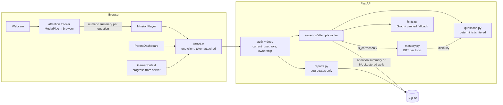

# MathVerse — Audit and Cleanup Plan

> **Status:** all five phases (A–E) have been carried out. This document is kept as the record of what was found in the original code and what was agreed. For how the system works now, see [ARCHITECTURE.md](ARCHITECTURE.md) and [PRIVACY.md](PRIVACY.md). File paths and line numbers in section 2 refer to the code as it was before the cleanup.

## Context

MathVerse (FastAPI + SQLite backend, React/Vite frontend) was built over many AI-tool sessions. It boots, but the four weak areas (backend, eye tracking, ML, parent dashboard) are held together by hardcoded values, unauthenticated endpoints and metrics that are not real. This document is the audit plus a phased plan. **No source code has been changed.** On approval, step 0 is to save this file as `docs/AUDIT_AND_PLAN.md` on a new branch, then build one phase at a time, stopping after each with a summary and test steps.

The brief's "what each part is supposed to do" placeholders were not filled in, so intent was taken from `README.md` and the code. Correct anything in section 3 that does not match what you meant.

Decisions already made by you (this session): simple mastery model instead of the LSTM; eye tracking moves into the browser; deterministic question generator with the LLM only for hints; keep teacher role, demo login and multiple children per parent; remove course-template files.

### Revision 2 — your seven additions, and what they changed

All audit findings, architecture decisions, feature decisions and phases A–E are kept. The additions are merged into sections 3–8 (marked **[R2]**). Four points in the first draft conflicted with them; each is resolved as follows.

| # | Conflict | Resolution |
|---|---|---|
| 1 | Draft section 4 lowered difficulty one tier when the last `attention_score` was low. Addition 2 says attention must never touch mastery and camera-less students must get the same academic experience. | **Removed.** Attention feeds nothing academic: not mastery, not difficulty, not points, not unlocks. It is recorded and displayed only. |
| 2 | Draft kept Gwen's hints tailored to the attention state (as the current code does). Same rule applies. | Hints depend only on the question, topic and mastery. The `cognitive_state` parameter is dropped from hint generation. |
| 3 | Standard BKT applies a "learning" step after every answer, so at very low mastery a **wrong** answer can raise the number (e.g. 0.05 → 0.16). Addition 2 requires incorrect answers to decrease mastery. | The learning step is applied only after correct answers. Then a correct answer always raises mastery and an incorrect one always lowers it; a unit test checks this across the whole 0–1 range. |
| 4 | You named Phase C "BKT mastery and deterministic question generation"; the draft ported the generator in Phase A because server-side answer checking needs it. | Split, nothing dropped: Phase A ports the generator at one tier (enough for the server to judge answers); Phase C adds easy/medium/hard tiers and BKT-driven selection. |

### Revision 3 — three watch-points made into commitments

| Watch-point | What the plan now commits to |
|---|---|
| BKT variation must be explainable | Phase C delivers a "Mastery model" section in `docs/ARCHITECTURE.md`: the four parameters, the two update formulas, a worked example for one correct and one wrong answer, and a short "why we changed textbook BKT" paragraph (textbook BKT can raise mastery after a wrong answer at low values; we apply the learning step only after correct answers so wrong never raises it). The same explanation sits in the `mastery.py` docstring, and test T7 demonstrates the property. |
| Device-level consent is demo-grade only | `docs/PRIVACY.md` and the README get a "Before real deployment" section stating that device-level consent is suitable for the course demo only, and that real use with children needs verified parent/guardian consent plus a guardian control to switch the camera off for their child. It is recorded as known future work, not built in v1. |
| Demo data labelled and never mixed | `is_demo` is returned by `/auth/me` and by every report. The frontend shows a persistent "Demo account, sample data" banner on every screen for demo users. Demo and real accounts cannot be linked in either direction, and any query that spans more than one student (the teacher's student list) filters to the same `is_demo` value as the caller. T9 covers the backend rules; a Vitest check covers the banner. |

Consequences worth knowing before you approve:
- Tests 1–5 in Addition 6 are browser-side, so the frontend gains a test runner (Vitest + React Testing Library, camera mocked). Real hardware failures are still a manual check.
- Demo isolation needs one new column, `users.is_demo`, and a rule that demo and real accounts can never be linked to each other.
- "No image uploads" is guaranteed by design (the backend has no endpoint or field that accepts image data) and backed by tests; it is not something a test alone can prove.

---

## 1. Architecture as it is today

**Stack (from the code):** React 18 + TypeScript + Vite + Tailwind; FastAPI + SQLAlchemy + SQLite; PyTorch LSTM; MediaPipe FaceLandmarker and OpenCV running **on the server**; Groq LLM; scikit-learn TF-IDF. No router library, no API client, no tests.

```
Browser (localhost:5173)                         FastAPI (localhost:8001)
  MissionPlayer ── JPEG every 1.2s ───────────▶ /eye-track/frame ─▶ EyeTracker (in-memory, per user)
        │                                                              │ latest state + metrics (RAM only)
        ├── POST /attempts/?user_id= (no auth) ─▶ attempts.py ─────────┤
        │                                            ├─ LSTM predict_risk (synthetic weights)
        │                                            ├─ Groq: question + hint (3s timeout)
        │                                            └─ SQLite: mission_attempts, topic_mastery, users.points
        └── localStorage: user, token, points, unlocked bosses (second source of truth)
  ParentDashboard ── GET /reports/student/{id} ─▶ reports.py ─▶ SQLite + hardcoded text/badges/metrics
```

**Run status (read-only checks; servers were not started):**

| Check | Result |
|---|---|
| `import main` in `backend/` | Works in ~8s, 17 routes, LSTM weights load |
| Python deps | All present **globally** (no venv). `requirements.txt` omits `python-jose` and `scikit-learn`, so a clean install fails on import |
| `npm run typecheck` | **Fails**: 25 errors, all `'r' is possibly 'null'` in `ParentDashboard.tsx` (250–631) |
| `npm run lint` | 29 errors, 9 warnings |
| Tests | None exist; `pytest` not installed |
| DB | `backend/mathverse.db`: 1 student, 11 attempts, 4 tables never written (`questions`, `hint_history`, `learning_reports`, `badges`) |

---

## 2. Findings

🔴 Broken · 🟠 Inconsistent · 🟡 Messy but works. Paths are relative to the repo root.

### 2.1 Backend (API, database, auth)

| | Issue | Where |
|---|---|---|
| 🔴 | **Demo login is an account takeover.** Returns a valid token for the *first user with that role*, no password. Any role string also creates a user. | `backend/routers/auth.py:117-171` |
| 🔴 | **Attempt endpoints have no auth.** `user_id` is a query parameter; anyone can write attempts, points and level for any child. `bonus_points` is client-supplied. Unknown `user_id` silently creates a "Spider-Cadet" user. | `backend/routers/attempts.py:99-100, 133-134, 156-165, 196-197` |
| 🔴 | **`/users` is open.** `GET /users/{id}` returns any child's name, email and student code; `POST /users/` creates passwordless users. Unused by the frontend. | `backend/routers/users.py:13-26` |
| 🔴 | **A guardian can link to any child** with just an email, code or numeric ID; no consent from the student. `link-student` also accepts an unauthenticated `guardian_id` and has no role check. | `auth.py:42-63`, `backend/routers/reports.py:151-183` |
| 🔴 | **"Correct" is wrong everywhere.** The client sends points as `score` (5 for a wrong answer, 50+ for a right one). Backend treats `score > 0` as correct, so wrong answers raise mastery, count as correct for accuracy, and feed `correct=1` to the model. DB confirms: 7 of 11 attempts have score 5. | `frontend/src/components/MissionPlayer.tsx:314,330`; `attempts.py:46,166,180`; `reports.py:50` |
| 🔴 | Hardcoded JWT secret fallback and one global password salt in source. README claims bcrypt; code is PBKDF2 with a fixed salt. | `backend/auth_utils.py:8,12` |
| 🔴 | SQLite file with a real email and password hash is **tracked in git**. | `backend/mathverse.db` |
| 🟠 | Role is not validated on register (any string accepted; compared before lowercasing). | `auth.py:40,69` |
| 🟠 | Victory inserts a fake attempt row (`timeTaken=45`, `Focused`) that pollutes every statistic. Points are added per question *and* again on victory. | `attempts.py:201-209` |
| 🟠 | Three sources of truth for points/level/unlocks: DB, `mathverse_user` in localStorage, `mathverse_state_user_N` in localStorage. `useGameState` is a hook, not a context, so each component has its own copy. Its sync effect resets unlocks to `user.level` (never refreshed from the server) whenever points change, which re-locks a boss just unlocked. | `frontend/src/hooks/useGameState.ts:46-77`; `MissionPlayer.tsx:284-297` |
| 🟠 | `GET /missions/{id}` fires an LLM call in the background and throws the result away. | `backend/routers/missions.py:14-36` |
| 🟠 | `http://localhost:8001` hardcoded in 4 frontend files; no shared client; errors swallowed with `.catch(() => {})`. | `AuthContext.tsx:31`, `Dashboard.tsx:31`, `MissionPlayer.tsx:74-324`, `ParentDashboard.tsx:95` |
| 🟡 | CORS `*` with credentials; `create_all` instead of migrations; `seed.py` drops all tables on import; `print` logging; `KERAS_HOME`/`MPLCONFIGDIR` hacks in 4 files though Keras is not used. | `backend/main.py:2-3,20-26`; `backend/seed.py:9` |
| 🟡 | README lists files that do not exist (`lib/api.ts`, `GameContext.tsx`, `ProfileModal.tsx`, "PDF report generation"). Unused `@supabase/supabase-js`; leftover `.bolt/`; duplicate `.wav` files. | `README.md:101-146`; `frontend/package.json:14` |

### 2.2 Eye tracking

| | Issue | Where |
|---|---|---|
| 🔴 | **Frame rate makes the metrics impossible.** One frame per 1.2s (0.83 fps); the tracker assumes 30 fps. A blink needs 2 consecutive closed frames (2.4s eyes shut). Saccades (20–200 ms) and fixation durations cannot be measured at this rate. | `MissionPlayer.tsx:117-152`; `backend/ml/eye_tracker.py:384-393, 410-418, 454` |
| 🔴 | **Metrics are fabricated or mislabeled.** Blink rate = `18 + blinks*4 + closed*2`. "Pupil dilation" is iris size (irises do not dilate). "Gaze stability" is how close the face is to the frame centre. "Gaze" is iris position in the image, i.e. head position. Saccade rate is floored at 1.0. | `eye_tracker.py:396-404, 458-484` |
| 🔴 | **UI adds random jitter** to blink and gaze numbers every 2s. | `MissionPlayer.tsx:169-179` |
| 🔴 | **Nothing is stored.** Telemetry lives in a process dict (lost on restart, 30-min TTL). Only the state label is saved per attempt. Dashboard blink rate (18.0) and gaze stability (90) are constants. | `backend/routers/eye_tracking.py:171`; `reports.py:77-78` |
| 🔴 | When no face is found the MediaPipe path returns "normal" numbers and keeps the previous state, so a child who walks away still reads as Focused. The OpenCV fallback says Drifting instead. | `eye_tracker.py:291-303, 370-378` |
| 🟠 | **No calibration and no consent step.** Camera starts automatically on entering a mission. | `MissionPlayer.tsx:45, 105-110` |
| 🟠 | **Privacy claim is false.** README says frames are "analyzed locally"; they are uploaded to the server. For a product aimed at minors this matters. | `README.md:35` |
| 🟠 | The clickable "COGNITION" pill calls `/eye-track/simulate`, overriding real state; enabled by default. | `MissionPlayer.tsx:69-102`; `eye_tracking.py:37` |
| 🟠 | `/eye-track/frame` is the only gameplay endpoint that needs a token. On 401 the HUD keeps showing default "Focused, 18/m, 92%" as if live. | `eye_tracking.py:273`; `MissionPlayer.tsx:132-151` |
| 🟠 | Existing data shows the classifier is not meaningful: 9 Drifting, 2 Overwhelmed, 0 Focused across 11 real attempts. | `backend/mathverse.db` |
| 🟡 | Monkeypatches MediaPipe's private ctypes loader for Windows/Python 3.13; Haar-cascade fallback with constant values; dead desktop code (`EyeTrackingThread`, `get_dataset_row`); `FramePayload.correct/response_time_s` accepted and ignored. | `eye_tracker.py:175-199, 430-446, 529-675`; `eye_tracking.py:56-57` |

### 2.3 ML pipeline

| | Issue | Where |
|---|---|---|
| 🔴 | **Training data is 100% synthetic.** The generator invents students from hand-written rules and the label is the generator's own hidden `mastery` variable. The model learns to invert those rules. The "ASSISTments format" comment is not true. | `backend/ml/train_lstm.py:30-104`; `eye_tracker.py:432` |
| 🔴 | **Inference inputs do not match training.** `correct` is always 1 (score bug); the eye features are the fabricated ones above; live per-frame prediction appends a row with hardcoded `correct=1, response_time_s=15`. | `attempts.py:45-54`; `eye_tracking.py:147-156` |
| 🔴 | **Training bug:** shorter sequences are zero-padded at the end and the model reads the last timestep, i.e. padding. | `train_lstm.py:106-113`; `attention_model.py:28` |
| 🔴 | **Questions are unverified.** The LLM prompt shows `"correct_answer": "A"` as the example and every fallback question has the answer at A with unshuffled options. LLM maths is never checked before being shown to a child. | `backend/services/rag_tutor.py:90-96, 116-153` |
| 🟠 | History for the model is in RAM only and not per topic; it resets on restart and mixes all bosses. | `eye_tracking.py:95, 204-210` |
| 🟠 | Dashboard says mastery is "updated by the Knowledge Tracing LSTM"; it is a `+0.08 / −0.04` rule. | `attempts.py:176-183`; `ParentDashboard.tsx:496` |
| 🟠 | Each answer blocks on two sequential Groq calls (3s timeout each, no retries) while the UI advances after ~2.5s, so the AI question can replace one already on screen. A hint is generated for every question whether requested or not. | `attempts.py:78-92`; `MissionPlayer.tsx:354-363, 400-415` |
| 🟠 | "RAG vector store" is TF-IDF over 6 hardcoded entries that are always looked up by topic; it is a dictionary lookup. | `backend/services/vector_store.py:145-206` |
| 🟡 | Model class duplicated in two files; `predict_risk` returns success probability and the frontend calls it `predictedRisk` but labels it "Predicted Mastery". | `attention_model.py:12`, `train_lstm.py:11`, `MissionPlayer.tsx:47,752` |

The weights do load and respond sensibly to their own synthetic features (0.93 for five correct+Focused rows, 0.13 for five wrong+Overwhelmed), so the model is not garbage; it has just never seen real data.

### 2.4 Parental dashboard

| | Issue | Where |
|---|---|---|
| 🔴 | **Fake content presented as analysis.** The "AI summary" is a fixed template praising "stellar conceptual fluency" whatever the data; the recommendation is one fixed sentence; all five badges are hardcoded. | `reports.py:117-130` |
| 🔴 | Fallbacks invent data: `points or 850`, `level or 3`, `total_questions_attempted = max(total, 28)`, blink 18.0, gaze 90. | `reports.py:77-78, 137-140` |
| 🔴 | Accuracy is always ~100% (score bug). "Missions cleared X / 6" is really the attempt count. Every correct row prints "100% (+10 SP)". | `reports.py:50-56`; `ParentDashboard.tsx:359, 591` |
| 🔴 | TypeScript does not compile (25 null errors). | `ParentDashboard.tsx:231` |
| 🟠 | Student `Dashboard.tsx` reads `a.timestamp` and `report.student.points`; the API returns `date` and a flat `points`. Mission count is capped at 8 because it counts `recent_attempts`. | `Dashboard.tsx:74-92`; `reports.py:105-114` |
| 🟠 | Copy says "ADHD-Calibrated Diagnostics" and "live ADHD cognitive attention analytics". The app cannot diagnose anything; this is a medical claim about a child. | `ParentDashboard.tsx:171, 333` |
| 🟠 | One child per guardian (`linked_student_id`); no time trend, only totals. Teacher view is the parent view. | `backend/models.py:16` |
| 🟡 | Role separation is client-side only in `App.tsx`; the server check in `reports.py:34-45` is the one that counts and is correct. | `frontend/src/App.tsx:25-43` |

---

## 3. Target architecture

Principles:
1. The **server** owns truth: who is correct, points, unlocks, mastery.
2. The **browser** owns the camera: webcam data is processed locally and no image or video is ever uploaded or stored.
3. Everything shown on a dashboard comes from a stored row. Nothing is fabricated.
4. **[R2] Academic and attention are two separate tracks.** Mastery, difficulty, points and progression depend only on maths answers. Attention is optional, recorded beside each attempt, shown in its own panel, and read by nothing else.
5. **[R2] The camera is never required.** A student who declines, has no webcam, or turns it off mid-game gets the identical game.



**[R2]** `mastery.py` receives only `(topic, is_correct)`. Its function signature has no attention parameter, so the separation is enforced by the code's shape, not by convention.

**Folder layout** (keeps the current flat backend; no new package nesting):

```
backend/
  main.py  config.py  database.py  models.py  schemas.py  security.py  deps.py  seed.py
  routers/   auth.py  sessions.py  guardians.py  reports.py
  services/  curriculum.py  questions.py  mastery.py  hints.py  report_builder.py
  tests/     test_auth.py  test_sessions.py  test_mastery.py  test_questions.py  test_reports.py
  requirements.txt  .env.example
frontend/src/
  lib/       api.ts  attention/tracker.ts  attention/summary.ts
  context/   AuthContext.tsx  GameContext.tsx
  components/ (existing) + CameraConsent.tsx
docs/  AUDIT_AND_PLAN.md  ARCHITECTURE.md
```

**API contract** (all except register/login need a bearer token; identity comes from the token, never from a `user_id` parameter):

| Endpoint | Who | Request → Response |
|---|---|---|
| `POST /auth/register`, `POST /auth/login`, `GET /auth/me` | anyone / self | role limited to `student`, `parent`, `teacher` |
| `GET /health` | anyone | `{status, demo_mode}`; the frontend shows the demo buttons only when `demo_mode` is true |
| `POST /auth/demo/{role}` **[R2]** | only when `DEMO_MODE=true` (default `false`) | 404 when disabled; 422 for any role other than `student/parent/teacher`; looks up the one seeded account with `is_demo=true` for that role and returns its token; **never creates a user**; 404 if not seeded |
| `GET /students/me/progress` | student | `{points, level, unlocked_bosses, link_code}` |
| `POST /sessions` | student | `{boss_id}` → `{session_id, question}` |
| `POST /attempts/{id}/answer` | owning student | `{selected_index, response_time_ms, hint_used, attention?}` → `{correct, correct_index, points_awarded, mastery, session_status, next_question}` |
| `GET /attempts/{id}/hint` | owning student | → `{hint}` (LLM on demand, canned fallback) |
| `POST /guardians/links` | parent, teacher | `{link_code}` → linked student |
| `GET /guardians/students` | parent, teacher | list of linked children |
| `GET /students/{id}/report` | that student or a linked guardian | aggregates + daily trend; no invented fields |

`question` = `{attempt_id, text, options[4], topic, difficulty}`. The correct index stays on the server until the answer is submitted.
`attention` = `{face_present_pct, on_screen_pct, blink_rate_per_min, sample_seconds}` or `null` when the camera is off.

**[R2] Demo isolation.** Demo accounts are created only by `python seed.py --demo`, carry `is_demo=true`, and hold synthetic attempts. `POST /guardians/links` rejects any link where one side is a demo account and the other is not, so a demo guardian can never read a real child's records and a real guardian can never attach to a demo child. Demo tokens go through the same access checks as everyone else.

**[R2] Camera and privacy rules (frontend).**
- A consent screen appears before the first mission with two equal buttons: **Enable camera** and **Continue without camera**. The camera never starts on its own.
- Plain-language copy for a child and a parent, roughly: *"If you switch the camera on, MathVerse checks whether you are looking at the screen. It works inside this browser only. No pictures or video are saved or sent anywhere. It is a rough estimate, not a medical test, and it does not change your score. You can switch it off at any time."*
- A camera toggle stays visible in the mission HUD. Turning it off stops the stream immediately; questions answered afterwards store `attention = null`.
- Permission denied, no device, device busy or model failed to load: show one calm line ("Camera unavailable, carrying on without it") and continue. No retry loops, no blocking dialogs.
- The choice is remembered on that device and can be changed from the HUD toggle.
- Request schemas use `extra="forbid"`, and no endpoint accepts image, video or base64 fields.

---

## 4. Data model

```
users ──< guardian_links >── users          (guardian_id, student_id; many-to-many)
users ──< play_sessions ──< attempts
users ──< topic_mastery
```

| Table | Columns |
|---|---|
| `users` | id, name, email (unique), password_hash, role (`student/parent/teacher`, enforced), points, level, link_code (students), **is_demo [R2]**, created_at |
| `guardian_links` | guardian_id, student_id, created_at; unique pair |
| `play_sessions` | id, student_id, boss_id, topic, started_at, ended_at, status (`active/victory/defeat/abandoned`), correct_count, wrong_count, points_awarded |
| `attempts` | id, session_id, student_id, topic, difficulty, question_text, options_json, correct_index, selected_index, **is_correct**, response_time_ms, hint_used, points_awarded, mastery_before, mastery_after, attention columns (`face_present_pct, on_screen_pct, blink_rate_per_min, attention_score, attention_label`), served_at, answered_at |
| `topic_mastery` | student_id, topic, p_mastery, attempts_count, updated_at |

Gaze metrics and predictions are columns on `attempts` rather than separate tables: there is exactly one summary and one prediction per question, so separate tables would add joins for nothing. Dropped: `missions`, `questions`, `hint_history`, `learning_reports`, `badges` (never written; the six bosses/topics become a constant in `services/curriculum.py`, reusing `CURRICULUM_DATA` from `vector_store.py`).

**[R2] Nullability.** All five attention columns on `attempts` are nullable and default to NULL. NULL means "not measured" (camera declined, unavailable, or switched off) and is never converted to 0, to a label, or to a default. Reports count measured and unmeasured questions separately.

**Mastery model (`services/mastery.py`) [R2]:** Bayesian Knowledge Tracing, one value per student per topic, fixed parameters (guess 0.25 for four options, slip 0.10, learn 0.15, prior 0.30), clamped to 0.01–0.99.
- Input: `is_correct` for that topic. Nothing else. No attention, no response time, no hint flag.
- Correct answer: Bayesian update, then the learning step. Always increases mastery.
- Incorrect answer: Bayesian update only (no learning step). Always decreases mastery.
- Next difficulty for that topic: easy below 0.40, hard above 0.75, otherwise medium.
- About 60 lines, deterministic, unit-testable. A student with no camera gets exactly the same questions as one with a camera, given the same answers.

**Attention (`lib/attention/`) [R2]:** `@mediapipe/tasks-vision` FaceLandmarker running in the browser, only after the student chooses **Enable camera**. Per question: % of time a face was present, % of time the head was facing the screen (relative to a 5-second baseline taken right after consent), blinks per minute from the eye-blink blendshapes. `attention_score = on_screen_pct`; label `Focused / Partly focused / Distracted / Away`. Saccades, fixations, pupil dilation, "Impulsive" and "Overwhelmed" are dropped because a webcam cannot measure them. These values are written to the attempt row and read only by the attention panel of the dashboard.

"Answered very quickly" (a response-time fact, not an eye measurement) may be shown in the academic panel as a plain observation. It does not feed mastery either.

---

## 5. Remaining decisions (recommendation is the default if you say nothing)

| Decision | Options | Recommendation |
|---|---|---|
| Password hashing | `bcrypt` library vs. PBKDF2 with a per-user random salt (stdlib) | `bcrypt`; matches the README and is the standard answer in interviews. Existing account must be re-created either way. |
| Schema change | Alembic migrations vs. delete DB and reseed | Delete and reseed. One real user in the DB; Alembic is overhead at this size. |
| Guardian linking | Link by email (today) vs. link code the child reads from their own dashboard | Link code. It is the consent step: the parent needs something only the child's account shows. |
| Spider-Man characters, GIFs, audio | Keep vs. rename before any public deployment | Keep for the course demo; it is Marvel IP, so do not deploy publicly as-is. Your call. |
| Deployment target (Phase E) | Local only vs. Render/Railway + Vercel | Local + a README that works from a clean clone; add hosting only if the course needs a URL. |
| Wording | ~~Keep "ADHD diagnostics" vs. change~~ | **Decided [R2]:** all ADHD, diagnostic and "cognitive load" wording is removed; the feature is called "Attention estimates" with the line "an estimate, not a medical assessment". |
| Frontend test tooling **[R2]** | Vitest + React Testing Library with a mocked camera vs. Playwright end-to-end with a fake video device | Vitest. It covers tests 1–5 in seconds with no browser install. Playwright is more realistic but heavy for this project; real-camera behaviour stays a manual check. |
| Who controls the camera **[R2]** | Child chooses on the device (as specified) vs. also let a linked parent switch it off for their child | Child chooses on the device for v1. A parent override is a reasonable later addition (one boolean on the student), not needed to meet the requirements. |
| Demo accounts' data **[R2]** | Seed a fixed synthetic history vs. start demo accounts empty | Seed a small fixed history (about 30 attempts over 10 days, some with attention values, some NULL) so the dashboards have something to show; label the account "Demo" in the UI. |
| What the README says about AI **[R2]** | Keep "LSTM / RAG / Deep Knowledge Tracing" headlines vs. describe what exists | Describe what exists: BKT mastery, deterministic questions, LLM-written hints, browser-side attention estimate. |

---

## 6. Roadmap

**Working rules [R2].** One Git branch per phase, each cut from the previous one: `phase-a-backend-foundation`, `phase-b-optional-attention`, `phase-c-mastery-questions`, `phase-d-dashboards`, `phase-e-tests-cleanup-docs`. Nothing is pushed to `origin` (a shared team repo) without your explicit permission. After every phase I stop and report: files changed, features implemented, tests executed, test results, remaining issues, manual testing instructions.

Tests are written in the phase that builds the feature, not saved for Phase E. The numbers in brackets (T1–T12) refer to the test matrix below.

### Step 0 — Save the audit (10 min)
Create `phase-a-backend-foundation`, write this document to `docs/AUDIT_AND_PLAN.md`.

### Phase A — Backend foundation and security (2–3 days) · mostly refactor
- **Goals:** clean install works; every endpoint authenticated; server decides correctness, points, unlocks; one API client.
- **[R2] Added to this phase:** strict role validation (`student/parent/teacher`, anything else is 422); `DEMO_MODE=false` default in `config.py`; demo endpoint rewritten per section 3; `users.is_demo`; `seed.py --demo` creating the three demo accounts with synthetic history; demo/real link isolation; `is_demo` exposed on `/auth/me` and a persistent "Demo account, sample data" banner in the frontend; `GET /health`; request schemas with `extra="forbid"`; game is playable start to finish with **no camera code involved** (the old frame upload is switched off here and removed in B); pytest set up now with T8, T9, T10, T12. Until Phase C, mastery uses the existing step rule but driven by the real `is_correct`.
- **Backend:** `requirements.txt` (pin, add `python-jose`, `bcrypt`, `pytest`, `httpx`; drop `mediapipe`, `opencv-python`, `torch`), new `config.py` + `.env.example` (JWT secret required, `DEMO_MODE`, CORS origins), `auth_utils.py` → `security.py`, new `deps.py` (`current_user`, `require_role`, `require_student_access`), rewrite `models.py`/`schemas.py` to section 4, `routers/attempts.py` → `routers/sessions.py`, new `routers/guardians.py`, `services/questions.py` (port of `frontend/src/lib/QuestionGenerator.ts` at a single tier; the three tiers arrive in Phase C), `seed.py` behind `if __name__ == "__main__"`, untrack `mathverse.db`.
- **Frontend:** new `lib/api.ts`; `AuthContext.tsx` uses it; `useGameState.ts` → `GameContext.tsx` fed by `/students/me/progress`; `MissionPlayer.tsx` uses sessions/answer endpoints and stops computing points; fix `ParentDashboard.tsx` null errors.
- **Rewrite justified:** `attempts.py` only. Its contract (client-sent score, `user_id` param, LLM in the request path) is the root of four 🔴 findings; patching it keeps the wrong shape.
- **Done when:** fresh venv + `pip install -r requirements.txt` + `uvicorn` boots; `npm run typecheck` passes; a wrong answer is stored as `is_correct=false` and lowers accuracy; calling any endpoint without a token returns 401, with another student's token 403; refresh keeps points and unlocks. **[R2]** With `DEMO_MODE` unset the demo endpoint returns 404; with it on, it returns only seeded demo accounts and the user count does not change; T8, T9, T10, T12 pass.

### Phase B — Optional browser-based attention tracking (2 days) · rewrite
- **Goals:** real, stored attention data; no images leave the browser.
- **[R2] Added to this phase:** consent screen with **Enable camera** / **Continue without camera**; plain-language explanation; HUD camera toggle that works mid-session; graceful handling of denial, missing device, busy device and model-load failure; choice remembered per device; attention sent as `null` whenever not measured; Vitest + React Testing Library added with a mocked `getUserMedia`; tests T1–T5.
- **Files:** new `frontend/src/lib/attention/tracker.ts`, `summary.ts`, `components/CameraConsent.tsx`; `MissionPlayer.tsx` (remove frame upload, jitter, simulate pill); move `face_landmarker.task` to `frontend/public/`; attention columns filled by `POST /attempts/{id}/answer`; delete `backend/ml/eye_tracker.py`, `backend/routers/eye_tracking.py`.
- **Rewrite justified:** the server tracker's design (sub-1 fps uploads) cannot produce the metrics it reports, and uploading children's faces contradicts the stated privacy model.
- **Done when:** camera prompt explains what is measured and can be declined (game still works, attention is `null`); looking away for a question yields a low `on_screen_pct` in the DB row; covering the camera yields `Away`; the network tab shows no image uploads. **[R2]** A full mission can be won with the camera declined, denied by the browser, or switched off halfway, with identical points and unlocks; T1–T5 pass.

### Phase C — BKT mastery and deterministic question generation (1.5 days) · replace
- **Goals:** adaptive difficulty from real data; hints on demand.
- **Files:** new `services/mastery.py`; `sessions.py` calls it on every answer; `services/rag_tutor.py` → `services/hints.py` (keep `generate_gwen_hint` and its fallback text, called only from `GET /attempts/{id}/hint`); `vector_store.py` → `services/curriculum.py` (data kept, TF-IDF removed); delete `backend/ml/`.
- **[R2] Added to this phase:** `services/questions.py` gains easy/medium/hard tiers for all six topics; BKT per topic with the correct-only learning step; `mastery.update(p, is_correct)` has no attention argument; hints lose the `cognitive_state` input; the "Mastery model" write-up in `docs/ARCHITECTURE.md` and the `mastery.py` docstring (see Revision 3); tests T6 and T7, plus a generator test that every generated question's stored answer is mathematically right and appears exactly once in the options.
- **Done when:** unit tests show mastery rising on correct and falling on wrong answers; five correct answers in a row move the next question to hard, five wrong to easy; the game is fully playable with no `GROQ_API_KEY`. **[R2]** Two students giving the same answers, one with full attention data and one with `null`, end with identical mastery, difficulty sequence and points (T6).

### Phase D — Real parent and teacher dashboards (1.5 days) · refactor
- **Goals:** every number traceable to rows; multiple children; teacher sees the same view over their linked students.
- **Files:** `routers/reports.py` + new `services/report_builder.py` (accuracy, time, per-topic mastery, weak topics, attention by day for 14 days; summary sentence built from thresholds, labelled as rule-based); `ParentDashboard.tsx` (child picker, trend chart, link-code form, empty states, wording); `Dashboard.tsx` field names.
- **[R2] Added to this phase:**
  - Two visibly separate panels. **Learning progress**: accuracy, questions answered, time practised, mastery per topic, weakest topics, and trends over time (daily accuracy, daily practice time, mastery per topic taken from `attempts.mastery_after`). **Attention estimates (optional)**: on-screen %, shown with "measured on N of M questions" and the line "an estimate from the webcam, not a medical assessment and not a measure of ability".
  - Missing camera data is shown as "Camera not used, no estimate" and is excluded from every average. It is never drawn as zero, low, or "Distracted".
  - No sentence, colour or score combines attention with academic results.
  - Badges are either computed from stored rows (e.g. "first boss defeated") or removed; no hardcoded list. The free-text "AI summary" is replaced by short statements generated from thresholds on real numbers, or omitted when there is too little data.
  - Honest empty state for a child with no attempts ("No practice recorded yet").
  - Teacher sees a list of linked students and opens the same per-student view; a privacy explainer is reachable from the dashboard.
  - Tests T11 and the dashboard half of T12; T10 extended to the report endpoint.
- **Done when:** a new account shows empty states, not sample numbers; numbers match a manual SQL count; a parent with two children can switch; unlinked guardian gets 403. **[R2]** A child who never used the camera shows a complete learning panel and an attention panel that says so; T11 passes against a seeded dataset with hand-computed expected values.

### Phase E — Testing, cleanup and documentation (1.5 days)
- `backend/tests/` with pytest + FastAPI TestClient (auth, access control, session flow, mastery, question correctness for all six bosses × three tiers); a small CI workflow running pytest, typecheck and lint.
- Rewrite `README.md` to match reality (setup from a clean clone, honest description of the attention estimate and mastery model); `docs/ARCHITECTURE.md` with the diagram and data model for interview use.
- Deletions in section 7.
- **[R2] Added to this phase:** fill any gaps so all of T1–T12 exist and run in CI (pytest + Vitest); `docs/PRIVACY.md` in plain language (what the camera does, what is stored, what is never stored, how to switch it off, and a "Before real deployment" section on parent/guardian consent and controls); a repo-wide search confirming no "ADHD", "diagnos", "cognitive load" or "clinical" wording remains in UI, API or README; README states what the AI parts really are.
- **Done when:** `pytest`, `npm run test`, `npm run typecheck`, `npm run lint`, `npm run build` all pass from a clean clone following only the README.

### Test matrix [R2]

| # | Requirement | How it is tested | Phase |
|---|---|---|---|
| T1 | Gameplay without camera permission | Vitest: choose "Continue without camera", play a mission against a mocked API, assert every answer payload has `attention: null` and the session reaches victory. Pytest: session flow with `attention=null` awards normal points and unlocks | B (backend half in A) |
| T2 | Gameplay with camera permission | Vitest: mocked `getUserMedia` and a stubbed tracker emitting samples; answer payload carries a numeric summary. Pytest: summary is stored on the attempt row | B |
| T3 | Camera permission denial | Vitest: `getUserMedia` rejects with `NotAllowedError` (and `NotFoundError`); the notice is shown, the game continues, `attention: null` | B |
| T4 | Camera disabled during a session | Vitest: toggle off after question 2; stream tracks are stopped; later answers send `attention: null`; earlier ones keep their values | B |
| T5 | No webcam image uploads | Vitest: spy on every request made during a camera-on mission; no body contains a Blob, `data:image`, or base64 image. Pytest: answer endpoint rejects extra fields (422); OpenAPI schema contains no image/binary field | B |
| T6 | Mastery unchanged by attention | Pytest: same answer sequence with high, low and `null` attention gives identical mastery, difficulty and points | C |
| T7 | Correct/incorrect update BKT appropriately | Pytest: correct always increases and incorrect always decreases across p = 0.01…0.99; topics are independent; difficulty thresholds | C |
| T8 | Demo login unavailable when `DEMO_MODE=false` | Pytest: default config returns 404 for all three roles | A |
| T9 | Demo login only reaches seeded demo accounts | Pytest: with real users present and demo on, the token belongs to an `is_demo` user; user count unchanged; invalid role 422; unseeded 404; demo/real linking rejected | A |
| T10 | Parent and teacher access restrictions | Pytest: unlinked guardian 403; student cannot read another student; student cannot call guardian endpoints; no token 401 | A, D |
| T11 | Dashboard statistics match the database | Pytest: seed known attempts, compare every report field with hand-computed values, including NULL-attention rows being excluded from averages | D |
| T12 | Multiple children linked to one parent | Pytest: link two children, list returns both, each report is separate, a third unlinked child is 403 | A, D |

---

## 7. What to delete

| Delete | Why |
|---|---|
| `backend/ml/` (`eye_tracker.py`, `attention_model.py`, `train_lstm.py`, `lstm_weights.pt`) | Replaced by browser tracker and `mastery.py`; stays in git history |
| `backend/routers/eye_tracking.py`, `users.py`, `missions.py` | Replaced / unauthenticated / unused |
| `backend/services/vector_store.py` (TF-IDF part) | Dictionary lookup dressed as a vector store |
| `backend/.keras/`, `backend/.matplotlib/`, the `KERAS_HOME` lines | Keras and matplotlib are not used |
| `backend/mathverse.db` from git; `C:\Users\parth\Desktop\SE\mathverse.db` (stale, old schema, outside the repo) | Personal data in git; orphan file. I will ask before touching the one outside the repo |
| `frontend/src/lib/QuestionGenerator.ts`, `hooks/useGameState.ts` | Moved to the server / replaced by `GameContext` |
| `@supabase/supabase-js`, `frontend/.bolt/`, `frontend/drotto*.wav` (duplicates of `public/`) | Unused leftovers |
| `code/`, root `Makefile`, `pyproject.toml`, `mkdocs.yml`, `.github/workflows/mkdocs.yml`, `assets/`, `docs/assets`, `docs/journals` stubs | Course template, per your answer. `journals/`, `project-proposal/`, `srs/` are coursework and stay. Worth a word with teammates first since the repo is shared |
| Demo fallback user and `mock_jwt_token_demo` in `AuthContext.tsx:112-128` | Fake login when the backend is down |
| **[R2]** On-demand user creation inside demo login (`auth.py:122-163`) | Demo login must never create accounts |
| **[R2]** Camera auto-start (`MissionPlayer.tsx:45`), frame upload loop (`:105-166`), random jitter (`:169-179`), simulate pill (`:69-102, 729-745`) | Replaced by consent screen, local processing and real values |
| **[R2]** `cognitiveState` column and the Focused/Drifting/Impulsive/Overwhelmed vocabulary everywhere | Not measurable; replaced by nullable attention columns |
| **[R2]** Attention input to difficulty and hints (`attempts.py:67-72`, `rag_tutor.py:177-185, 212-219`) | Attention must not influence anything academic |
| **[R2]** Hardcoded badges, template "AI summary", fixed recommendation, `or 850` / `or 3` / `max(total, 28)` fallbacks (`reports.py:77-78, 117-140`) | Fabricated content |
| **[R2]** "ADHD-Calibrated Diagnostics", "ADHD cognitive attention analytics", "Clinical ADHD Biomarkers", "Cognitive Load" wording (`ParentDashboard.tsx:171, 333, 413`; `README.md:15, 25-34`) | Medical claims the product cannot support |

---

## 8. Risks and things not verified

- **Not run end to end.** Plan mode is read-only: no servers started, no browser session, no camera test, no Groq call. Findings on runtime behaviour (question swapping, re-locking bosses) come from reading the code.
- **Groq key.** `backend/.env` is git-ignored and was never committed. Its value did appear in this session's tool output when the file was read, so rotating it in the Groq console is a cheap precaution. Whether model `openai/gpt-oss-120b` answers within the 3s timeout is unknown.
- **Browser MediaPipe** performance on low-end laptops and the exact `@mediapipe/tasks-vision` API need checking against current docs when Phase B starts. Head-pose "facing the screen" is an estimate, not gaze tracking; the docs and UI must say so.
- **BKT parameters** are textbook defaults, not fitted. Honest framing: "standard BKT with fixed parameters; fitting needs real usage data".
- **Existing data** (1 user, 11 attempts) is discarded by the schema change.
- **Shared repo.** Three other contributors push to `origin/master`; phases should land as reviewable branches.
- **Intent.** If the project report or SRS promises the LSTM or four cognitive states, the write-up needs to change with the code. I did not read the PDFs.
- **[R2] Consent by a child.** The consent screen is answered by whoever is at the keyboard, usually the child. That meets the requirements as written; it is not verified parental consent. If the project is ever used with real children outside a demo, a parent-side control is the next step (see section 5).
- **[R2] Camera tests use a mocked camera.** T1–T5 prove the app's logic. Real permission prompts, real hardware errors and real tracking accuracy can only be checked by hand in a browser, and will be listed in each phase's manual test steps.
- **[R2] "Facing the screen" is coarse.** A child reading the question with their head turned slightly, or wearing glasses in poor light, may read as off-screen. This is why the value is labelled an estimate, kept out of everything academic, and never shown as a judgement.
- **[R2] BKT variant.** Skipping the learning step on wrong answers is a deliberate departure from textbook BKT to guarantee "wrong never raises mastery". It should be stated as such in `docs/ARCHITECTURE.md`.
- **[R2] Demo data is synthetic** and must be labelled so in the UI, so a demo dashboard is never mistaken for a real child's record.
- **[R2] Third-party assets.** `MissionPlayer.tsx` loads a sound from `actions.google.com` and a background from `images.unsplash.com`; for a children's app these external requests should be replaced with local files in Phase E.

---

## Verification (per phase, repeated in each phase summary)

1. `cd backend && python -m venv venv && venv\Scripts\activate && pip install -r requirements.txt && pytest`
2. `uvicorn main:app --port 8001 --reload`, then `python seed.py` for demo accounts
3. `cd frontend && npm install && npm run typecheck && npm run lint && npm run dev`
4. Manual pass in the browser pane: register student → play a mission with deliberate wrong answers → check accuracy; register parent → link with the child's code → compare dashboard numbers with `sqlite3 mathverse.db "select is_correct, count(*) from attempts group by 1"`
5. Access control with curl: no token → 401; other student's token → 403
6. **[R2]** `npm run test` (Vitest) for T1–T5; `pytest` for T6–T12
7. **[R2]** Camera, by hand: decline on the consent screen and win a mission; allow, then block the camera in browser site settings and reload; switch the HUD toggle off mid-mission; in each case compare points with a camera-on run and confirm the Network tab shows no image payloads
8. **[R2]** Demo: start the backend with no `DEMO_MODE` and confirm the demo buttons are hidden and `POST /auth/demo/student` is 404; set `DEMO_MODE=true`, run `python seed.py --demo`, confirm one click logs into the labelled demo account
