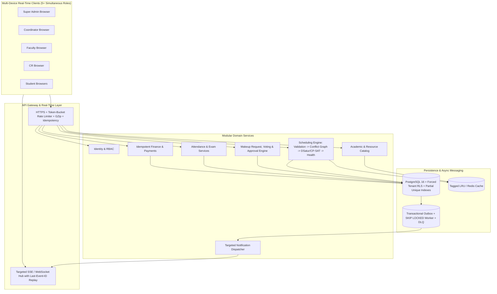
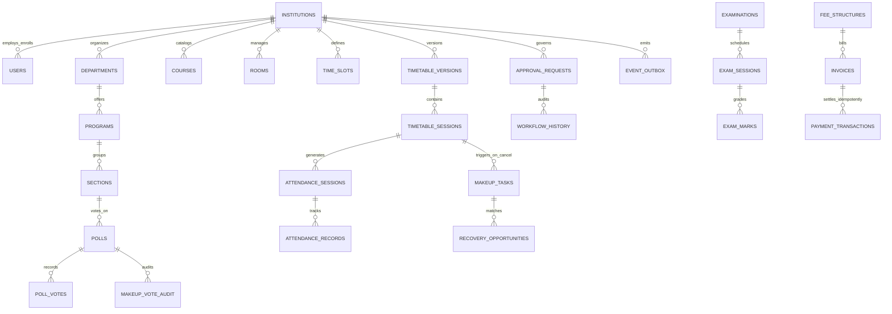
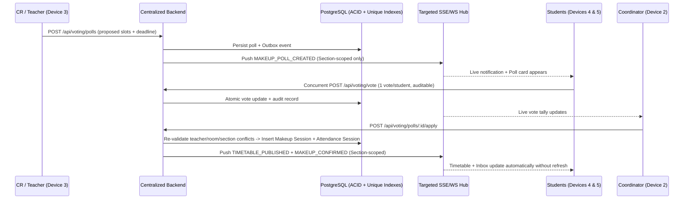

# IntelliSchedule — Enterprise University Management Architecture (HLD, LLD & ER)

## 1. High-Level Architecture (100,000+ Students / 10,000+ Teachers / 10,000+ Rooms)

## 2. Entity-Relationship Diagram (Normalized 9-Domain Schema, Migrations 0001–0005)

## 3. Sequence Diagram — Makeup Request -> Multi-Device Student Voting -> Conflict-Checked Approval -> Attendance

## 4. Applied Design Patterns & Concurrency Controls
- **Repository & Service Layers:** Clear separation between PostgreSQL persistence (`models.py`, `supabaseStore.ts`) and domain orchestration (`solver.py`, `university_engine.py`).
- **Strategy Pattern:** Pluggable scheduling optimization (`DSatur` + optional `OR-Tools CP-SAT`) and recovery matching (`CROSS_CANCELLATION`, `SAME_DAY`, `FUTURE_SLOT`).
- **Observer / Pub-Sub Pattern:** `TargetedNotificationHub` & `/api/events/stream` SSE hub with role/section authorization and `Last-Event-ID` reconnect replay.
- **Transactional Outbox + SKIP LOCKED + DLQ:** Guaranteed at-least-once event dispatch (`worker.py`) with exponential backoff and dead-lettering after 5 attempts.
- **Database Hard-Constraint Uniqueness:** Partial unique indexes (`tt_sessions_no_faculty_clash_uq`, `tt_sessions_no_room_clash_uq`, `tt_sessions_no_section_clash_uq`, `att_records_unique_student_session`, `payment_tx_idempotency_uq`) prevent double-booking, duplicate attendance, and duplicate payment callbacks even under concurrent load.
